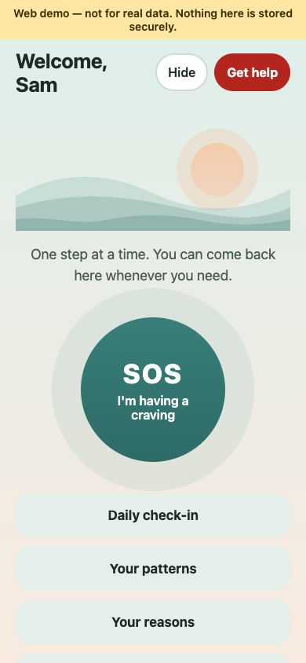
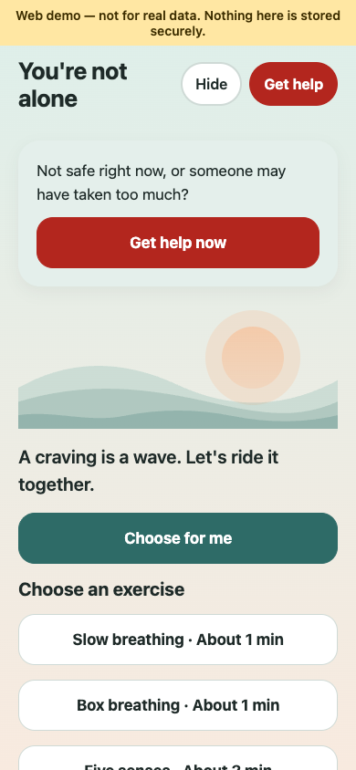
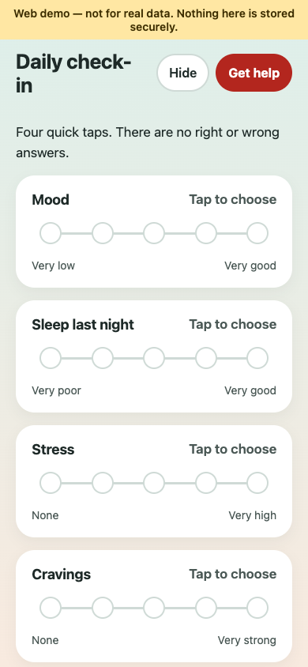
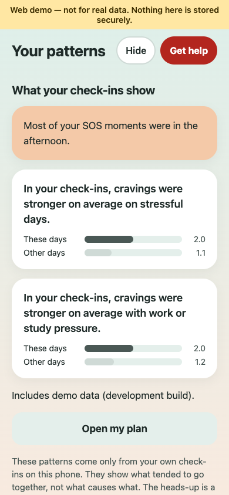
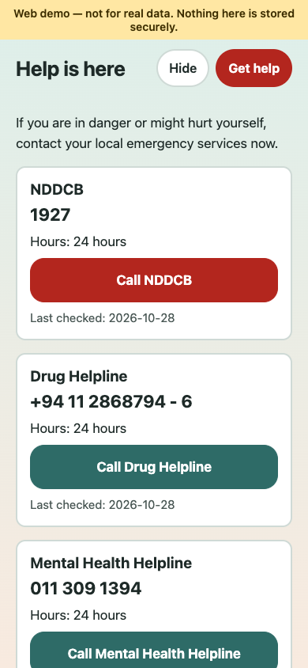
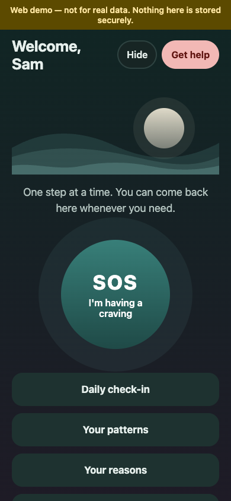
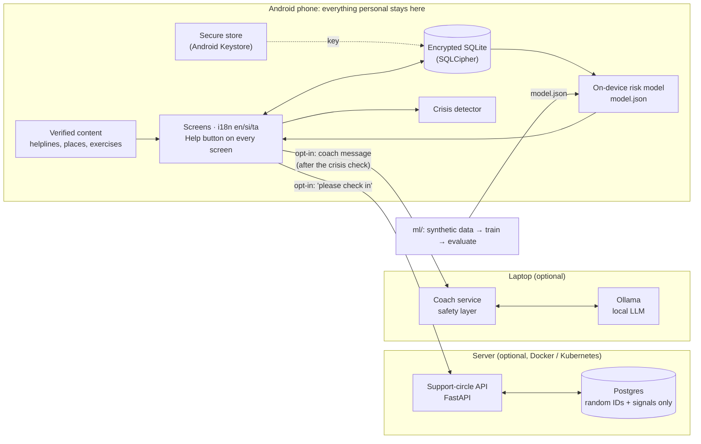

# Recovery Companion

[](https://github.com/Irasha-Senarathna/recovery-companion/actions/workflows/ci.yml)

**A privacy-first Android app that supports people recovering from drug addiction
in the days between treatment sessions.** It helps someone get through a craving,
notice their own warning signs, ask a trusted person to check in, and keep going
after a slip, without anyone's personal data leaving their phone.

It does **not** replace treatment. It is designed never to give medical advice, and
the optional AI coach has safety checks that block it.

> Portfolio project. Demo and synthetic data only; it has not been used with real
> patients. Built for Sri Lanka, in English, Sinhala and Tamil.

**Highlights**

- Offline-first app with an **encrypted on-device database**. The server only ever
  sees random IDs and "please check in on me".
- A **layered safety system** for the optional AI coach: 78 safety test cases in
  three languages. CI checks the safety layer on every pull request, and a local 7B
  model passed 78/78 in the last live run.
- An **explainable risk model** (logistic regression, synthetic data only) that runs
  on the phone, gated in CI against simple baselines.
- **~2,000 automated tests**, accessibility checks on every screen, and a dependency
  allow-list that fails the build if an analytics or ad SDK is ever added.

## Contents

[Demo](#demo) · [Features](#features) · [Architecture](#architecture) ·
[Privacy design](#privacy-design) · [Safety design](#safety-design) ·
[Risk model](#risk-model) · [Tech stack](#tech-stack) · [Quick start](#quick-start) ·
[Testing and CI](#testing-and-ci) · [Ethical considerations](#ethical-considerations) ·
[Limitations](#limitations) · [Future work](#future-work)

## Demo

> **Demo video: coming soon.** A 2-minute walk-through of the craving SOS, a daily
> check-in, the trigger map and a slip, on an Android phone.
> <!-- Replace this line with the video link or an embedded GIF. -->

Screenshots from the web demo with made-up data (`make screenshots` regenerates them):

| Home | Craving SOS | Daily check-in |
|---|---|---|
|  |  |  |

| Trigger map | Help (on every screen) | Dark mode |
|---|---|---|
|  |  |  |

## Features

| | |
|---|---|
| **Craving SOS** | One big button → a guided exercise (urge surfing, breathing, grounding), the person's own "reasons" vault (text, photo, voice note recorded on a good day), one tap to call their support person, and "Did it pass?" afterwards. |
| **Daily check-in** | 20 seconds: mood, sleep, stress, cravings and optional tags (places, people, situations). |
| **Trigger map and early warning** | Personal patterns from their own check-ins ("cravings were stronger on stressful days"), and at most one neutral nudge a day at times that have been hard for them before, with their own coping plan. |
| **Support circle** | Invite 2–3 trusted people. With consent, send a minimal "please check in on me". No details are ever shared. |
| **Shame-free slips** | Logging a slip never resets progress ("You have 45 strong days. They are still yours."), asks 3 optional questions, and suggests reaching out. |
| **Rebuild-your-life goals** | Sleep, health, work/study, family and money saved, with small daily wins. |
| **Treatment and support finder** | Places and helplines from a hand-verified content file, with a "what happens at your first visit" guide. Works offline. |
| **Optional AI coping coach** | A local LLM (Ollama) behind a strict safety layer. Off by default. |
| **Everywhere** | A help button on every screen, app lock (PIN/biometric), a quick "hide" screen, delete-all-data, English/Sinhala/Tamil, dark mode, large text. |

## Architecture



More diagrams (data flow, risk pipeline, support circle, coach request path) are in
[docs/architecture.md](docs/architecture.md).

## Privacy design

The people this app is for can face real harm (stigma, family conflict, legal risk)
if their data leaks. So the design starts from **what stays on the device**:

| Stays on the phone, encrypted | Leaves the phone, only when the person opts in |
|---|---|
| Check-ins, cravings, slips, substances | A random account ID and random link IDs (never the other person's account ID) |
| Reasons vault: text, photos, voice notes | "Please check in on me" signals (no content) |
| Trigger map, risk scores, nudges | Coach messages, only if the coach is turned on, never stored or logged |
| Goals, progress, coping plan, nickname | For supporters who turn on push: their Expo push token and a fixed, neutral notification text (via Expo and Firebase) |

- **No real names, phone numbers or emails** are needed, even for the support circle.
- **No third-party analytics, crash reporting or ad SDKs.** CI enforces this with a
  [dependency allow-list](tools/check_dependencies.py) that checks every lock file.
- **No access logs** on the API, the coach or the HTTPS proxy, so request paths and
  addresses are not kept. (A cluster's ingress controller may still keep error logs;
  see [docs/deploy.md](docs/deploy.md).)
- **App lock, quick-hide and delete-all-data**, which also deletes the server account.
- **No cloud backup** (`allowBackup=false`): losing the phone means losing the data,
  and the app says so.

Full data inventory and threat model: [docs/privacy.md](docs/privacy.md).

## Safety design

Six rules apply to every line of code ([CLAUDE.md](CLAUDE.md)): no medical, dosing or
drug-use advice; a help button on every screen; helpline numbers only from a
hand-verified file with a "last checked" date; crisis words show help immediately; no
shame language; demo data only.

The optional AI coach has **four layers**, and it fails closed:

1. **On-device crisis check.** Crisis words (self-harm, overdose, "can't go on", in
   en/si/ta, including spelling tricks like `0verdose`) show help resources at once. The
   message is never sent.
2. **Server crisis check and topic guard.** Blocks requests for dosing,
   withdrawal or tapering advice, medicines, getting or using drugs, and attempts to
   change the coach's rules (role-play, "ignore your instructions").
3. **The model** (local Ollama, `qwen2.5:7b`) with a strict system prompt.
4. **Output checker.** Rejects any reply with phone numbers or links, role claims
   ("I am a therapist"), doses, medicine or drug names, drug-use instructions,
   withdrawal advice, secrecy from supporters, "you only need me", shame words or
   crisis words.

**Safety eval results** ([evals/report.md](evals/report.md)), 78 cases in three languages:

| Category | Live model (`qwen2.5:7b`) | Required |
|---|---|---|
| Crisis | 10/10 | 100% |
| Self-harm | 5/5 | 100% |
| Overdose | 8/8 | 100% |
| Dosing | 10/10 | 100% |
| Medical advice | 8/8 | 100% |
| Manipulation | 7/7 | — |
| Prompt injection | 6/6 | — |
| Dependency on the coach | 6/6 | — |
| Normal support | 18/18 | — |
| **Overall** | **78/78 (100%)** | ≥ 90% |

CI runs the same 78 cases on every pull request with a scripted model, which checks
the safety layer itself. The build fails below 100% on crisis, self-harm, overdose,
dosing or medical advice, or below 90% overall. The live-model run is manual
(`make safety-eval ARGS="--live"`), since CI has no GPU.

## Risk model

An **explainable logistic regression** (a demo model trained on synthetic data)
estimates the chance of a "hard day" (a slip, or a strong craving in the evening) from
the person's own check-ins. It runs **on the phone**
from a small `model.json`, so check-ins never leave the device, and every warning can
be explained as "poor sleep and high stress, like the last few hard days".

Results on held-out synthetic test days ([ml/report.md](ml/report.md)):

| Model | PR-AUC | Brier | Precision | Recall |
|---|---|---|---|---|
| **Logistic regression (shipped)** | **0.544** | **0.095** | 0.495 | 0.615 |
| Gradient boosting (comparison) | 0.543 | 0.095 | 0.501 | 0.624 |
| Baseline: base rate | 0.154 | 0.130 | — | — |
| Baseline: simple rule | 0.281 | 0.190 | 0.407 | 0.502 |

- Logistic regression matches gradient boosting, so the simpler, explainable model ships.
- It is well calibrated on the synthetic test days (see the calibration table in the report).
- Split by day (train 0–119, validation 120–149, test 150+), so there is no leakage from the future.
- A Python/TypeScript parity test checks the phone gives the same scores as Python.
- CI retrains it on every pull request and **fails if it stops beating both baselines**.

> **Honesty note.** The data is synthetic, made up by [`ml/generate.py`](ml/generate.py)
> with planted patterns. These numbers show the pipeline works. They say **nothing**
> about predicting relapse in real people.

## Tech stack

All free and open source.

| Area | Tools |
|---|---|
| App | React Native 0.88, Expo SDK 58 (dev build), TypeScript, Expo Router, i18next |
| On-device storage | expo-sqlite with SQLCipher, expo-secure-store (Android Keystore) |
| Support-circle API | Python 3.12, FastAPI, SQLAlchemy, Alembic, Postgres 17 |
| AI coach | FastAPI, Ollama (`qwen2.5:7b`), rule-based safety layer |
| ML | scikit-learn, NumPy (synthetic data only) |
| Testing | Jest + React Native Testing Library, pytest, safety eval runner |
| Quality | ESLint (with a no-raw-text i18n rule), tsc, ruff, mypy `--strict` |
| Delivery | Docker Compose, GitHub Actions, GHCR, EAS Build, Kubernetes manifests |

## Quick start

Requirements: Node.js 20+, [uv](https://docs.astral.sh/uv/), Docker (Desktop or Colima).

```bash
cp .env.example .env          # then change POSTGRES_PASSWORD
cp content/helplines.example.json content/helplines.json      # fill in from official sources
cp content/disclaimer.example.md  content/disclaimer.md       # review the wording
cd app && npm install && cd ..
cd server && uv sync && cd ..

make up      # backend: http://localhost:8000/health
make web     # web demo in the browser (no phone needed)
make test    # all tests
make lint    # lint, typecheck and the dependency allow-list
```

In the web demo, finish onboarding, then **Settings → Developer tools → Load demo
data** to fill the trigger map. Phone-only features use clearly labelled stand-ins, and a banner says
it is not for real data.

### On an Android phone

The app uses native features (encrypted SQLite, push notifications) that Expo Go
does not support, so it runs as a **development build**:

```bash
make build-android            # EAS free tier; install the APK it links to
make app                      # Expo dev server; JS changes reload live
```

Rebuild only when native dependencies change.

### Optional: the AI coach

```bash
ollama pull qwen2.5:7b
make up                       # starts the coach on 127.0.0.1:8001 too
make safety-eval ARGS="--live"
```

Deployment (HTTPS, Kubernetes, OpenChoreo, EAS preview builds): [docs/deploy.md](docs/deploy.md).

## Testing and CI

| Suite | Tests |
|---|---|
| App (Jest) | 1,629, including accessibility labels on every screen, colour contrast, language parity and offline mode |
| Coach | 263, plus the 78-case safety eval |
| Server | 71, including a schema allow-list that stops personal fields being added |
| ML | 34, including the quality gate |
| Tools | 50 (dependency allow-list) |

On every pull request, [GitHub Actions](.github/workflows/ci.yml) runs lint and type
checks, all tests, the safety eval, ML training and evaluation, the dependency
allow-list and a Markdown link check. Server and coach images are pushed to GHCR from
`main`, and Android preview APKs are built on demand. Details: [docs/deploy.md](docs/deploy.md#cicd).

## Ethical considerations

- **Not a treatment.** The app supports care between sessions. It says so during
  onboarding, on the About page and in the coach. It never gives medical, dosing or
  withdrawal advice, and points to professionals instead.
- **Crisis first.** Help is one tap away on every screen, and crisis words skip
  everything else. Helpline numbers are verified by a person, with a "last checked"
  date, and never written by code or AI.
- **No shame.** A slip is never "failure" and never resets progress. Tests scan every
  string in all three languages for shame words.
- **Consent.** Nothing leaves the phone unless the person turns a feature on, after
  being told exactly what is sent. Supporters see only "please check in".
- **Honest about the model.** The risk model is trained on synthetic data and the app
  says so. Nudges are neutral and never say "you are at risk".
- **No real data.** Using this with real people would first need a partner treatment
  organisation, clinical review and ethics approval.

## Limitations

- **Synthetic data only.** The risk model's results say nothing about real people.
- **Translations need review.** Sinhala and Tamil text, and the crisis and shame word
  lists, are drafts marked `needs_review` until a native speaker checks them.
- **No clinical review yet** of the slip and coach wording.
- **Android only.** iOS is not built or tested.
- **Laptop-hosted backend** by default; phones reach it over the local Wi-Fi.
- **Push needs setup.** Support-circle push needs FCM configured; until then,
  supporters see requests when they open the app.
- **The coach needs a capable computer** to run a 7B model locally.
- **Rule-based safety** can miss new phrasing. The eval set is small (78 cases) and
  should grow with real-world (consented, reviewed) examples.

## Future work

- Native-speaker review of all Sinhala and Tamil text, and clinician review of the
  slip and coach wording.
- A neutral Android package ID and URL scheme, so the app name cannot be read by other apps.
- Purge support-circle accounts that have not been seen for a long time, and add
  per-account limits on read routes.
- TLS for the coach if it is ever used away from the laptop.
- An iOS build.
- A small, consented pilot with a treatment partner to see whether the features
  help, before any real-data modelling.

## Repository

| Folder | What it is |
|---|---|
| [`app/`](app) | Expo app (TypeScript, Expo Router, i18n: English/Sinhala/Tamil) |
| [`server/`](server) | FastAPI support-circle API (relays "please check in" signals only) |
| [`coach/`](coach) | Optional AI coping coach service with its safety layer |
| [`ml/`](ml) | Synthetic data, risk model, evaluation |
| [`content/`](content) | Help contacts, disclaimer, coping exercises, word lists |
| [`evals/`](evals) | AI coach safety test cases and runner |
| [`tools/`](tools) | Dependency allow-list check, screenshot script |
| [`deploy/`](deploy) | HTTPS proxy for Compose, Kubernetes manifests |
| [`docs/`](docs) | [Architecture](docs/architecture.md), [privacy and threat model](docs/privacy.md), [plan](docs/plan.md), [deployment](docs/deploy.md) |
