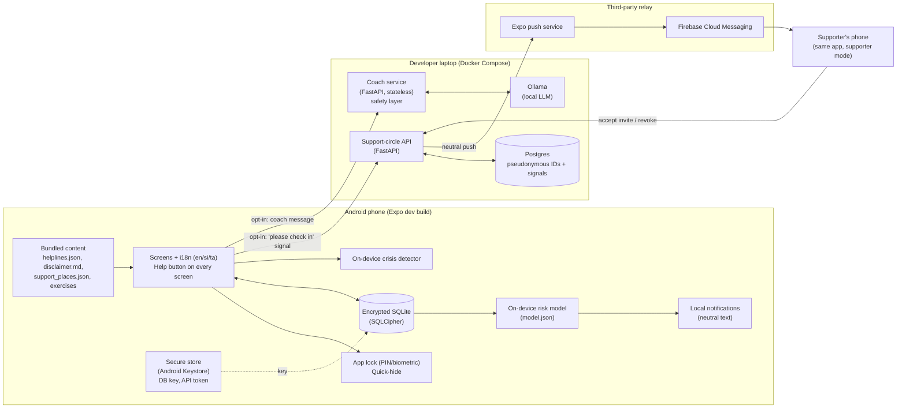
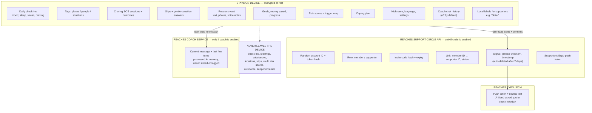
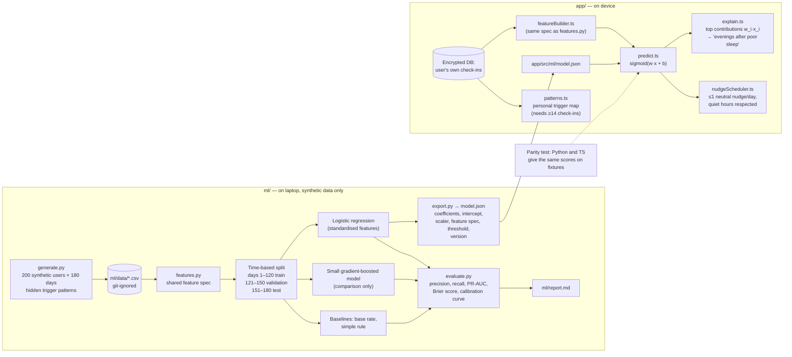
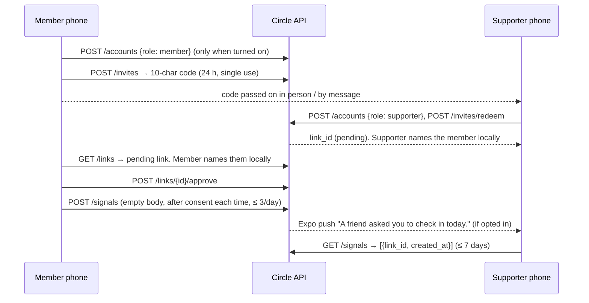
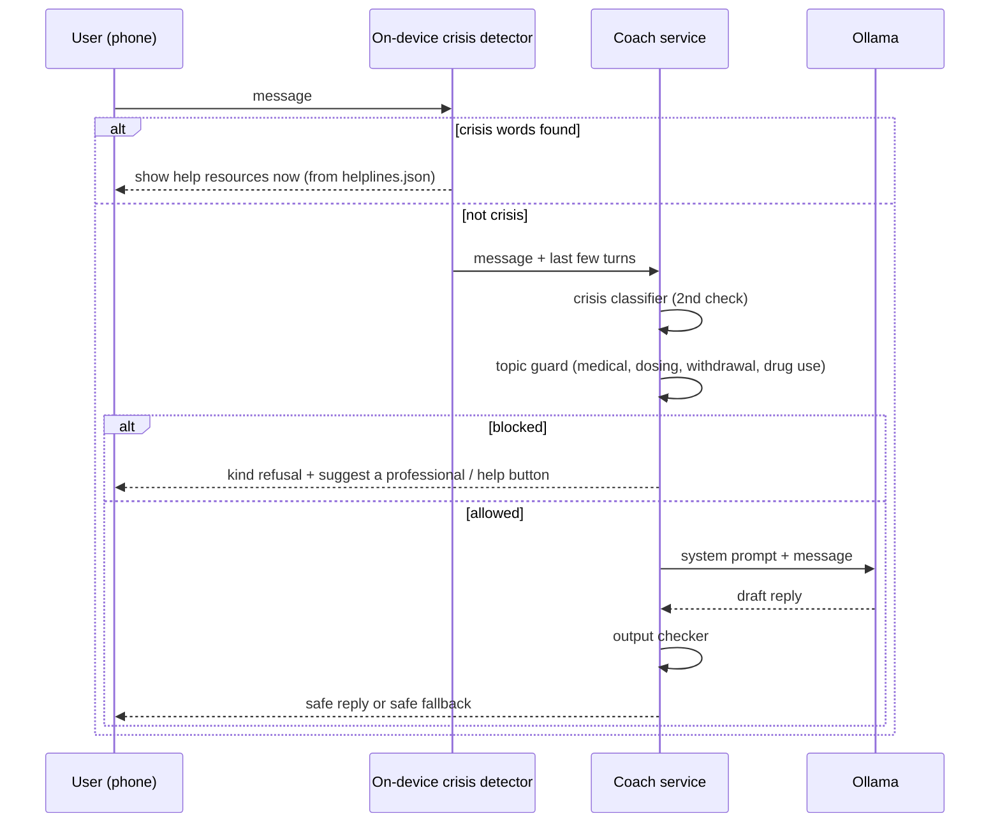

# Architecture — Recovery Companion

Status: **draft for approval**. No code exists yet; this describes the target design.

Recovery Companion is an offline-first Android app. Almost everything runs on
the phone. Two small, optional services run on the developer's laptop (Docker
Compose): a **support-circle API** that relays "please check in on me" signals,
and a **coach service** that wraps a local Ollama model behind a safety layer.

## Key decisions

| # | Decision | Why |
|---|---|---|
| D1 | Android first, built as an **Expo development build** with **EAS Build (free tier)**, which makes an installable APK in the cloud. Not Expo Go | SQLCipher and remote push notifications do not work in Expo Go. EAS's free tier needs no Android Studio and no paid account. After the dev build is installed, JS changes reload live from `npx expo start --dev-client`. A rebuild is needed only when native dependencies change. |
| D2 | **expo-sqlite with SQLCipher** (`useSQLCipher` config plugin). Random 256-bit key generated on first launch, kept in `expo-secure-store` (Android Keystore) | Full-database encryption at rest, as CLAUDE.md requires. |
| D3 | Photos and voice notes (reasons vault) are stored as **BLOBs inside the encrypted DB**, with size limits | Media is never left unencrypted on the file system. |
| D4 | **Risk model runs on the device**: logistic regression trained in `ml/` on synthetic data, exported as `model.json` (coefficients + feature spec), and run in TypeScript | Check-ins never leave the phone, and each prediction can be explained as a sum of feature contributions. |
| D5 | Early-warning nudges are **local scheduled notifications** with neutral text | No server is involved in the risk logic. |
| D6 | The **support circle is opt-in**. A server account is created only when the user turns the feature on. Supporters use the **same app in "supporter mode"** | No phone numbers, emails or names are needed. The server holds only random IDs. |
| D7 | The **coach service is a separate, stateless container**, apart from the support-circle API and its database. It is off by default and the user opts in with a clear notice | Coach text never shares a process or database with circle data. Nothing is logged or stored. |
| D8 | Backend runs **on the laptop only** (Docker Compose). Phones reach it on the same Wi-Fi | Zero cost, and nothing is exposed to the public internet. |
| D9 | **No cloud backup**. Android `allowBackup=false` | Data lives only on the device. Losing the phone means losing the data; the app says this clearly. |
| D10 | All content (helplines, disclaimer, support places, exercises) is **bundled JSON/Markdown** read at runtime, never hard-coded | Safety rule 3. `helplines.json` and `disclaimer.md` are edited by the developer only, after checking official sources. |
| D11 | Region: **Sri Lanka**. Languages: English, Sinhala, Tamil | Matches the target audience. Sinhala and Tamil strings carry a `needs_review` marker until a native speaker checks them. |
| D12 | The app also **runs in a web browser during development** (`npx expo start`, press `w`). Phone-only features (encrypted SQLite, secure store, biometrics, notifications, shake) sit behind small platform adapters (`*.native.ts` / `*.web.ts`). The web versions are clearly labelled demo stand-ins: in-memory storage (sql.js, pure JS, unencrypted, gone on reload), a "Simulate notification" button, a PIN instead of biometrics, no shake | Fast UI development and easy demos without a phone. The web stand-in never stores real sensitive data and is not shipped as a product. Android behaviour is unchanged. |
| D13 | `helplines.json` and `disclaimer.md` are **created by the developer** from `*.example.*` templates. Claude cannot write these files (protected by a hook) | Keeps the verified safety content entirely under human control. |

## 1. System overview



### Components

| Component | Location | Responsibility |
|---|---|---|
| `app/` | Phone | All features. Offline-first; works with no network apart from the support circle and the coach. |
| `app/src/storage` | Phone | Opens the SQLCipher DB, runs migrations, and implements delete-all (drop DB, delete key, cancel notifications, delete server account). |
| `app/src/ml` | Phone | Feature builder plus logistic-regression inference from `model.json`, and per-feature explanations. |
| `app/src/safety` | Phone | Crisis-word detector (en/si/ta) that opens help resources immediately, before any network call. |
| `server/` | Laptop | Support-circle API: register, invites, links, signals, push tokens, revoke, delete account. |
| `coach/` | Laptop | Stateless coach: crisis detector → topic guard → Ollama → output checker. Logs no message bodies. |
| `ml/` | Laptop | Synthetic data generator, training, evaluation report, model export. |
| `evals/` | Laptop | Coach safety cases (YAML) and runner; pass rates per category. |
| `content/` | Repo | Developer-verified content. Bundled into the app at build time. |

> Note: `coach/` is a new top-level folder that CLAUDE.md does not list yet.
> Milestone 9 adds it to CLAUDE.md's folder list.

## 2. Data flow: what stays on the device and what leaves it



Rules this flow enforces:

- The server schema has an **allow-list of columns**. A test fails if a column
  is added that is not on the list (milestone 6).
- The app has **one network module per service** (`circleClient`, `coachClient`).
  A test checks that no other module imports `fetch` or an HTTP client.
- The **crisis detector runs on the device first**. Crisis messages show help
  resources immediately and are not sent to the coach.

## 3. Risk-model pipeline



- **Prediction target** (M5): a "hard day": a slip that day, or a strong
  craving (intensity ≥ 3 on the 0–4 scale) from 17:00 on, given that day's
  check-in and earlier ones. The scale and tags are shared with the app through
  `content/checkin.json`; the planted patterns are listed in `ml/README.md`.
- **Features** (M5): mood, sleep, stress, craving (0–4), poor-sleep and
  high-stress flags, weekend, the sleep + stress + weekend combination,
  3-day craving and stress averages, and one flag per tag. Days since the last
  slip arrives with slips in M7.
- **Honesty note**: the model is trained and tested on synthetic data. Its
  metrics show the pipeline works. They do **not** show it predicts real
  relapse risk. The README and the trigger-map screen say this.

## 4. Support circle (milestone 6)



- Each side knows a link only by its `link_id`; the API never returns the other
  side's account ID. Names ("Sister") live in `circle_labels` on each phone.
- Errors come back as short codes (`circle_full`, `daily_limit`, ...) that the
  app translates. Rate limits live in server memory only.
- The app reads the server address from `EXPO_PUBLIC_CIRCLE_API_URL`. Without it
  the circle shows as "not set up on this version". The web demo needs
  `SERVER_CORS_ORIGINS` and gets no push ("Check for requests" instead).
- Alembic migrations run when the server container starts.

## 5. Coach request path (milestone 9)



## Repository layout (target)

```
app/          Expo app (TypeScript)
  src/screens  src/components  src/features/<feature>
  src/storage  src/ml  src/safety  src/i18n/{en,si,ta}.json
  src/net/{circleClient,coachClient}.ts  src/theme  src/navigation
server/       FastAPI support-circle API + Alembic migrations + tests
coach/        FastAPI coach service + safety layer + tests
ml/           generate.py, features.py, train.py, evaluate.py, export.py, report.md
content/      helplines.json*, disclaimer.md*, support_places.json, exercises/
evals/        safety_cases.yaml, run_eval.py, report.md
docs/         architecture.md, privacy.md, plan.md, deploy.md
* edited by the developer only (protected by a hook)
```
