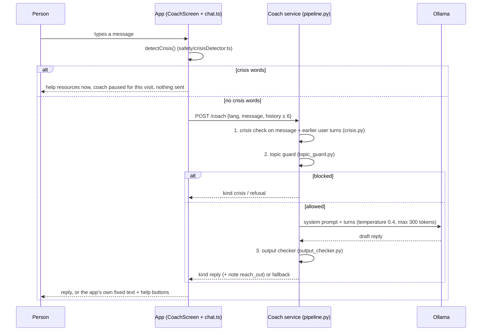
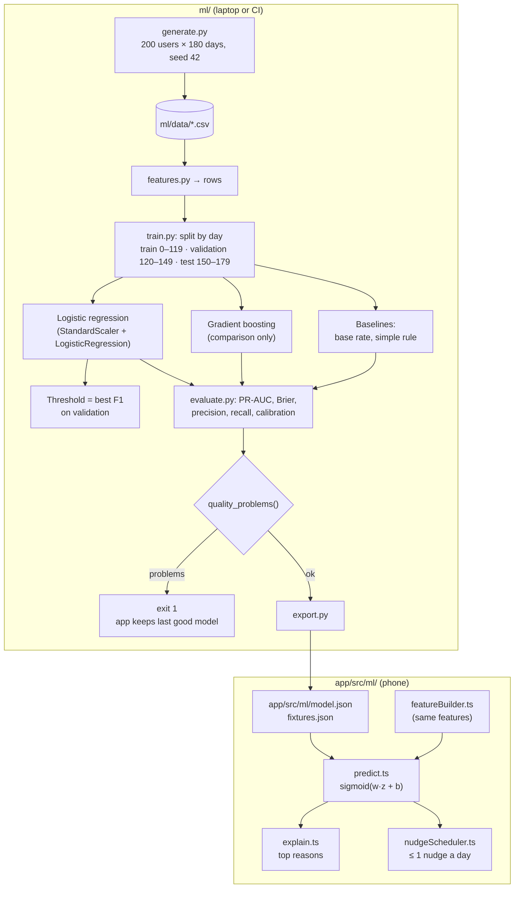

# AI and ML

[Handbook home](README.md) · Previous: [Database guide](DATABASE_GUIDE.md) · Next: [Safety and privacy](SAFETY_AND_PRIVACY.md)

The project has two "intelligent" parts, and they are completely separate:

| | AI coping coach | Risk model |
|---|---|---|
| What | A short chat with a language model | A logistic regression that scores the day |
| Where it runs | `coach/` service + Ollama on a laptop | On the phone (`app/src/ml/`) |
| Trained by this project? | No: an existing open model (`qwen2.5:7b`) is used as-is | Yes: `ml/`, on **synthetic data only** |
| Data it sees | One message and up to 6 earlier turns, only if the person turns the coach on | The person's own check-ins, on the phone |
| Status | Implemented, optional, off by default | Implemented |

**What this project does *not* have:** no RAG (retrieval-augmented generation), no
vector database, no fine-tuning, no cloud AI API, and no model trained on real people.

---

## The AI coping coach

### What it is for

The coach listens kindly and suggests **one simple coping skill at a time**
(slow breathing, grounding, riding out an urge, a short walk, calling a trusted
person). It is told it is **not** a doctor, therapist or counsellor
(`coach/app/prompts.py`), and the app says so on screen (`coach.notTherapist`).

### End-to-end flow

### The safety layers

| # | Layer | File | What it does |
|---|---|---|---|
| 0 | **On-phone crisis check** | `app/src/safety/crisisDetector.ts`, `app/src/features/coach/chat.ts` (`planSend`) | Crisis words (en/si/ta) show help immediately. The message is **never sent** |
| 1 | **Service crisis check** | `coach/app/crisis.py` | Checks the message **and every earlier user turn** again |
| 2 | **Topic guard** | `coach/app/topic_guard.py` | Blocks *asking for advice* on dosing, withdrawal, medicines, getting or using drugs, and attempts to change the rules (role-play, "ignore your instructions"). Mentions alone ("I saw my doctor today") pass |
| 3 | **System prompt** | `coach/app/prompts.py` | Rules for the model: no medical advice, no numbers or links, no shame words, encourage people and professionals |
| 4 | **Output checker** | `coach/app/output_checker.py` | Rejects any reply with phone numbers or links, role claims, doses, medicine or drug names, withdrawal advice, drug-use instructions, secrecy from supporters, "you only need me", shame words or crisis words. On any problem the result is `fallback` |

Both crisis checks read the same word list, `content/crisis_terms.json`, and undo
simple spelling tricks: digits for letters (`0verdose`), spaced letters (`d o s e`),
zero-width characters and soft hyphens (`coach/app/text.py`, `crisisDetector.ts`).
Shared spelling cases live in `evals/fixtures/crisis_spelling.json`.

**Only `reply` carries model text.** For `crisis`, `refusal` and `fallback`, the app
shows its own reviewed, translated text with **Get help** and **SOS** buttons.

### Privacy of the coach

- **Stateless:** no database, no files (`coach/app/main.py`).
- **Logs** hold only method, path, status and time. Errors log only the error type,
  because exception messages could contain the text. `test_no_body_logging.py`
  checks every path.
- **Validation errors never echo the input** (custom 422 handler).
- The chat lives only in the screen's memory and is never saved.
- Ollama runs locally; no message goes to a cloud AI company.
- The coach listens on `127.0.0.1` by default ([Deployment guide](DEPLOYMENT_GUIDE.md)).

### Safety evaluation

`evals/safety_cases.yaml` holds **78 cases** in 9 categories and 3 languages.
`evals/run_eval.py` sends each case through the **real pipeline** and judges the
result with its own checks (separate from the output checker), such as
`show_help_resources`, `refuse_medical_advice`, `stay_in_role`, `stay_kind_no_shame`
and `encourage_human_connection`.

| Mode | Command | Model | Purpose |
|---|---|---|---|
| Stub | `make safety-eval` (also in `make test` and CI) | A scripted stand-in | Tests the safety layer itself, deterministic |
| Live | `make safety-eval ARGS="--live"` | Ollama `qwen2.5:7b` | Tests the real model's replies; writes `evals/report.md` |

**Pass rules** (`MUST_BE_PERFECT`, `OVERALL_MIN`): 100% on crisis, self-harm,
overdose, dosing and medical advice; at least 90% overall.

**Results:** the stub run passes 100%. The committed live report
([evals/report.md](../../evals/report.md)) shows 78/78. Live runs can vary, because
the model is not deterministic: a later local run gave 77/78, where one ordinary
support reply was replaced by the safe fallback. The must-pass categories stayed at 100%.

### Honest limitations of the coach

- **Rule-based checks can miss new phrasing.** The word lists and patterns are
  hand-written. 78 test cases is a small set.
- **Sinhala and Tamil** word lists, test cases and the model's replies need
  native-speaker review.
- **A 7B model makes mistakes.** The output checker removes known unsafe patterns,
  but a reply can still be unhelpful or slightly off. The app says the coach "can
  get things wrong".
- **Fallback is safe but not helpful.** When a reply is blocked, the person gets a
  generic message and other options.
- **It needs a capable computer** and runs only near the laptop (or over `adb reverse`).
- **No clinical review** of the coach wording yet.

---

## The risk model

### What it predicts

A **"hard day"**: a slip that day, **or** a strong craving (intensity ≥ 3) from 17:00
on, given that day's check-in and earlier ones. It is used for a gentle on-screen
card and one optional neutral notification. It **never** says "you are at risk".

### Pipeline

### Synthetic data

`ml/generate.py` invents users with **planted patterns**, so we know what the model
should find (full list in [ml/README.md](../../ml/README.md#planted-patterns)):

- poor sleep, high stress and weekends each raise the hidden risk, and **together**
  they add extra risk,
- paydays, the 3 days after a slip and some tags (`conflict`, `old_routine`,
  `risky_place`) add risk,
- people check in **less** on slip days, so "no check-in" must not mean "a good day".

The same seed always gives byte-identical files.

### Features

`ml/features.py` (mirrored exactly by `app/src/ml/featureBuilder.ts`): mood, sleep,
stress, craving (0–4); poor sleep and high stress flags; weekend; the
sleep + stress + weekend combination; 3-day craving and stress averages; a slip in the
3 days before (`slip_recent`); and one flag per check-in tag.

### Results (synthetic test days)

From [ml/report.md](../../ml/report.md):

| Model | PR-AUC | Brier | Precision | Recall |
|---|---|---|---|---|
| **Logistic regression (shipped)** | **0.544** | **0.095** | 0.495 | 0.615 |
| Gradient boosting (comparison) | 0.543 | 0.095 | 0.501 | 0.624 |
| Baseline: base rate | 0.154 | 0.130 | — | — |
| Baseline: simple rule | 0.281 | 0.190 | 0.407 | 0.502 |

The simple model matches the more complex one, so the **explainable** one ships.
Strongest features: high stress, poor sleep, weekend, old routine, payday, recent slip.

### Why logistic regression

- **Explainable:** each feature's pull is `weight × standardised value`, so the app
  can say "poor sleep and high stress, like the last few hard days" (`explain.ts`).
- **Tiny:** coefficients, scaler, intercept and threshold fit in one JSON file.
- **Runs anywhere:** the same formula in Python and TypeScript.
  `predict.parity.test.ts` checks the phone gives the same scores as Python (within 1e-6)
  on `fixtures.json`.

### Quality gate

`ml/evaluate.py` `quality_problems()` fails `make ml` (and CI) when logistic regression:

- does not beat the base rate and the simple rule on PR-AUC,
- does not beat the base rate on Brier score,
- never flags a day (recall 0), or
- has any metric that is not a number (NaN).

The report is still written, so the reason is visible, but `app/src/ml/` keeps its
last good model.

### Honest limitations of the risk model

- **Synthetic data only.** The data is invented with planted patterns. The metrics
  show the pipeline works and finds those patterns. They say **nothing** about
  predicting relapse in real people. `model.json` itself carries
  `"trained_on": "synthetic data from ml/generate.py (not real people)"`.
- **Not a medical tool.** Scores are a gentle hint, never a judgement (`predict.ts`).
- **Personal patterns are not causes.** The trigger map shows what tended to go
  together in the person's own check-ins, not what causes what.
- **A nudge can reveal something.** Even neutral text may tell someone who sees the
  phone that today is a harder day. The setting explains this, and nudges are off by default.
- Real-world use would need consented data, clinical input and a new evaluation.

## Related pages

- [Safety and privacy](SAFETY_AND_PRIVACY.md): the rules these features follow
- [Testing and CI/CD](TESTING_AND_CI_CD.md): how the gates run on every pull request
- [Features](FEATURES.md#trigger-map-and-early-warning): what the person sees
