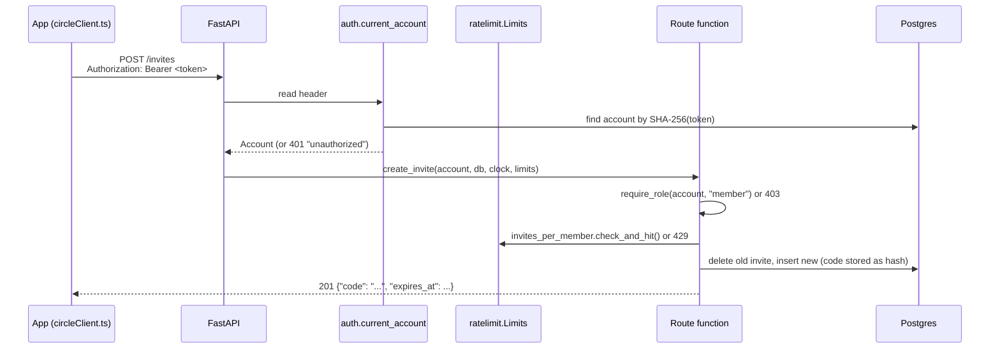

# Backend guide

[Handbook home](README.md) · Previous: [Tech stack](TECH_STACK.md) · Next: [API reference](API_REFERENCE.md)

The backend is the **support-circle API** in `server/`. It has one job: relay
"please check in on me" between people who know each other only by random IDs.
It never sees check-ins, cravings, substances, places or names.

The coach service (`coach/`) is a separate backend, explained in [AI and ML](AI_AND_ML.md).

## Folder map

| File | What it does |
|---|---|
| `server/app/main.py` | `create_app()`: builds the FastAPI app, CORS, proxy headers, routers, `/health`, the hourly purge loop |
| `server/app/config.py` | Settings from `SERVER_*` environment variables |
| `server/app/db.py` | Database engine and sessions (Postgres in Docker, SQLite in tests) |
| `server/app/models.py` | The 5 tables ([Database guide](DATABASE_GUIDE.md#server-database-postgres)) |
| `server/app/schemas.py` | Request and response bodies. Requests forbid unknown fields |
| `server/app/auth.py` | Tokens, hashing, `current_account`, `require_role` |
| `server/app/ratelimit.py` | In-memory sliding-window rate limits |
| `server/app/routes/accounts.py` | Create and delete accounts; push token |
| `server/app/routes/invites.py` | Create and redeem invite codes |
| `server/app/routes/links.py` | List, approve and revoke links |
| `server/app/routes/signals.py` | Send and list "please check in" signals |
| `server/app/push.py` | Neutral push through the Expo push service (off by default) |
| `server/app/purge.py` | Deletes old signals and expired invites |
| `server/alembic/versions/0001_support_circle.py` | The only migration: creates the schema |
| `server/tests/` | 71 pytest tests |

## How a request is handled



FastAPI **dependencies** (`Depends(...)`) provide the database session, the clock,
the limits and the current account. Tests replace the clock and the push sender
with fakes (`server/tests/conftest.py`).

## Authentication

There are no usernames or passwords.

1. When a person turns the circle on, the app calls `POST /accounts` with a role
   (`member` or `supporter`).
2. The server makes a random 256-bit token (`secrets.token_urlsafe(32)`), returns it
   **once**, and stores only `sha256(token)`.
3. The app keeps the token in the phone's secure store (`rc.circle_member` or
   `rc.circle_supporter`) and sends it as `Authorization: Bearer <token>`.
4. `auth.current_account` hashes the incoming token and looks it up. Missing,
   malformed (over 100 characters) or unknown tokens all get the same `401`.
5. `require_role` returns `403 wrong_role` when, for example, a supporter tries to
   create an invite.

One phone can have both a member and a supporter account. They are separate and
not linked on the server.

## Roles and what each can do

| Action | Member | Supporter |
|---|---|---|
| Create an invite code | ✓ | |
| Redeem an invite code | | ✓ |
| Approve a pending link | ✓ | |
| End a link | ✓ | ✓ |
| Send "please check in" | ✓ | |
| See recent requests | | ✓ |
| Register a push token | | ✓ |
| Delete own account | ✓ | ✓ |

## Business rules

| Rule | Value | Where |
|---|---|---|
| Supporters per member (pending + active) | 3 | `invites.MAX_SUPPORTERS` |
| Open invite codes per member | 1 (a new one replaces the old) | `create_invite` |
| Invite code | 10 characters, base32 (about 50 bits), single use | `invites.new_code` |
| Invite lifetime | 24 hours | `INVITE_TTL` |
| Signals per member | 3 per 24 hours | `signals.SIGNALS_PER_DAY` |
| Signal lifetime | 7 days | `purge.SIGNAL_TTL` |
| Supporter sees signals | Only those sent **after** the link was approved | `list_signals` |
| Signal body | Must be empty; anything sent is refused | `signals.no_body` |

**Unknown, used and expired codes all return the same `404 not_found`**, so an
attacker cannot tell them apart.

## Rate limits

`server/app/ratelimit.py` keeps sliding one-hour windows **in memory only** (never
written to disk):

| Limit | Per | Max per hour |
|---|---|---|
| `accounts_per_address` | Client address | 10 |
| `invites_per_member` | Member account | 10 |
| `bad_codes_per_account` | Supporter account | 5 wrong codes |
| `bad_codes_per_address` | Client address | 20 wrong codes |

Every redeem attempt counts **before** the lookup (so parallel requests cannot slip
past), and a correct code is refunded. Behind an HTTPS proxy, set
`SERVER_TRUSTED_PROXIES` so the API sees each client's real address
([Deployment guide](DEPLOYMENT_GUIDE.md#https-with-docker-compose)).

## Database operations

- **Sessions:** one per request (`db.get_session`), committed by the route.
- **Cascade deletes:** deleting an account removes its invites, links, signals and
  push token (`ON DELETE CASCADE`). This is how `DELETE /account` and the app's
  delete-all work.
- **Purge loop:** `main.purge_loop` runs every hour and calls `purge.purge()`. Errors
  are swallowed without logging details, and it tries again next hour.
- **Error-safe logging:** engines use `hide_parameters=True`, so IDs and hashes never
  appear in database error logs.

## Push notifications

`server/app/push.py`:

- `get_push_sender()` returns `DisabledPushSender` unless `SERVER_PUSH_ENABLED=true`.
- When enabled, after a signal is saved, a **background task** sends the fixed text
  ("A friend" / "A friend asked you to check in today.", or the Sinhala/Tamil
  version) to each active supporter's Expo push token.
- Tokens the push service reports as `DeviceNotRegistered` are deleted.
- The text matches the app's reviewed i18n strings; `tests/test_push.py` checks this.

## Configuration

All settings come from environment variables with the `SERVER_` prefix
(`server/app/config.py`). Real values go in `.env`, which is never committed; see
`.env.example`.

| Variable | Default | Meaning |
|---|---|---|
| `SERVER_DATABASE_URL` | empty | Full URL (tests, local runs). Otherwise the parts below are used |
| `SERVER_DB_HOST`, `SERVER_DB_NAME`, `SERVER_DB_USER`, `SERVER_DB_PASSWORD` | `localhost`, `recovery_companion`, empty, empty | Database connection parts (Docker Compose sets these) |
| `SERVER_ENABLE_DOCS` | `false` | Turns on `/docs` and `/openapi.json` |
| `SERVER_PUSH_ENABLED` | `false` | Sends real pushes through Expo |
| `SERVER_CORS_ORIGINS` | empty | Browser origins allowed (web demo only) |
| `SERVER_TRUSTED_PROXIES` | empty | Proxy addresses or networks whose `X-Forwarded-For` is trusted |

## Running and testing

```bash
make up            # Postgres + API (and coach) in Docker; API on :8000
make test-server   # pytest, using in-memory SQLite
make lint-server   # ruff, ruff format --check, mypy --strict
```

With `SERVER_ENABLE_DOCS=true`, FastAPI's interactive docs are at
`http://localhost:8000/docs`.

## Related pages

- [API reference](API_REFERENCE.md): every endpoint with examples
- [Database guide](DATABASE_GUIDE.md): tables and migrations
- [Safety and privacy](SAFETY_AND_PRIVACY.md): why the server knows so little
