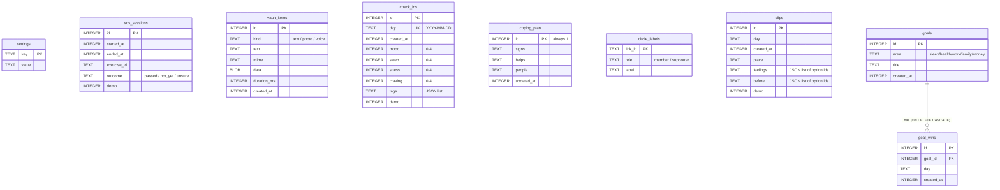
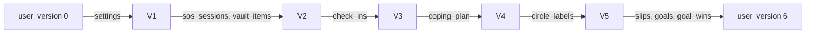
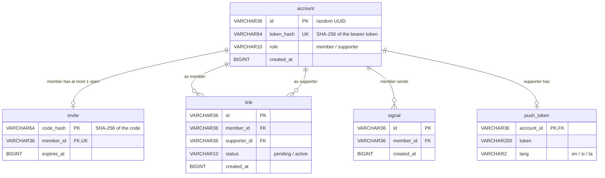

# Database guide

[Handbook home](README.md) · Previous: [API reference](API_REFERENCE.md) · Next: [AI and ML](AI_AND_ML.md)

The project has **two separate databases** that never share data:

| Database | Where | Holds | Encryption |
|---|---|---|---|
| [Phone database](#phone-database-sqlcipher) | The phone, file `recovery.db` | All personal data | SQLCipher, 256-bit key |
| [Server database](#server-database-postgres) | Postgres, only if the circle is used | Random IDs, hashes, timestamps | Disk encryption is up to the host (see [Deployment guide](DEPLOYMENT_GUIDE.md)) |

The coach service has **no database**.

## Phone database (SQLCipher)

Code: `app/src/storage/`. Schema: `app/src/storage/migrations/index.ts`.

### How it is opened

`storage/db.ts` `openDatabase(key)`:

1. Refuses to open without a valid key (`no_key`).
2. Checks SQLCipher is really present (`PRAGMA cipher_version`); otherwise refuses
   (`no_cipher`), because the data would be stored unencrypted.
3. Sets the raw 256-bit key (`PRAGMA key`).
4. Reads once to detect a wrong key (`wrong_key`).
5. Turns on `secure_delete`, so deleted content (such as a removed photo) is
   overwritten.
6. Runs migrations.

The key is random, made on first launch, and kept in the Android Keystore through
`expo-secure-store` (`storage/key.ts`, secure-store name `rc.db_key`).

In the **web demo**, `storage/db.web.ts` opens an **unencrypted in-memory** database
(sql.js) instead. It is gone on reload and is for made-up data only.

### Tables

| Table | Added in | Used by | Notes |
|---|---|---|---|
| `settings` | M2 | Everything | Key–value. Keys are typed in `storage/settings.ts` (`AppSettings`): nickname, language, reminders, support person, journey start, coach on/off and more |
| `sos_sessions` | M3 | SOS, stats, nudge timing | One row per SOS use, with the outcome |
| `vault_items` | M3 | Reasons vault | Photos and voice notes are **BLOBs** in the encrypted DB, never loose files |
| `check_ins` | M4 | Check-in, trigger map, risk model | One per local day (`day` is unique) |
| `coping_plan` | M5 | Trigger map, harder-day card | A single row (`id = 1`) |
| `circle_labels` | M6 | Support circle | The person's own private names for links. **Never sent to the server** |
| `slips` | M7 | Slip flow, progress, trigger map | Answers are fixed option IDs, never free text |
| `goals`, `goal_wins` | M7 | Goals | One win per goal per day (`UNIQUE (goal_id, day)`) |

The `demo` column marks made-up rows from **Developer tools → Load demo data**.
Clearing demo data removes only those rows, never the person's own.

### Secure store (not in the database)

`app/src/storage/secureKeys.ts` lists every secure-store entry: the database key,
the PIN hash and attempt counter, the biometric token, and the support-circle
accounts (`rc.circle_member`, `rc.circle_supporter`). `rc.circle_pending_delete`
(queued server deletions) is kept separately on purpose, so it survives delete-all
until the server confirms.

### Migrations

`migrations/index.ts` holds an ordered list of SQL strings. `migrate()` reads
`PRAGMA user_version`, runs each newer migration inside a transaction, and bumps
the version. **Never edit a shipped migration; add a new one at the end.**

### Data lifecycle on the phone

| Event | What happens |
|---|---|
| First launch | Key created, DB file created, migrations run |
| Normal use | Repositories (the `*Repo.ts` files in `app/src/features/`) insert and update rows |
| Removing an item | Row deleted; `secure_delete` overwrites the content |
| Delete all my data | Key deleted first (the file becomes unreadable), then the file, server accounts, secure store, biometrics, notifications and temporary media (`storage/deleteAll.ts`) |
| Uninstall | Android removes the app's files and Keystore entries. `allowBackup=false`, so nothing goes to cloud backup |

There is **no backup and no sync**. Losing the phone means losing the data, and the
app says so.

## Server database (Postgres)

Code: `server/app/models.py`. Migration: `server/alembic/versions/0001_support_circle.py`.

Every foreign key uses `ON DELETE CASCADE`. `link` has a unique `(member_id, supporter_id)` pair.

**What is not here:** names, phone numbers, emails, labels, check-ins, substances,
locations, IP addresses, message text. `server/tests/test_schema_allowlist.py`
checks that the models and the migration contain exactly the allowed columns, so a
new personal field cannot be added by accident.

### Migrations (Alembic)

- The server container runs `alembic upgrade head` every time it starts
  (`server/Dockerfile`), then starts the API.
- To change the schema: edit `models.py`, add a new file in `alembic/versions/`,
  update the allow-list test and [privacy.md](../privacy.md). Keep **one replica**
  while migrations run at start-up.

### Data lifecycle on the server

| Data | Created | Deleted |
|---|---|---|
| `account` | Circle or supporter mode turned on | `DELETE /account` (also from the app's delete-all) |
| `invite` | `POST /invites` | Used, replaced by a new one, or purged after 24 h |
| `link` | Invite redeemed (pending) | Either side ends it, or an account is deleted |
| `signal` | `POST /signals` | Purged after 7 days (hourly job) |
| `push_token` | Supporter turns notifications on | Turned off, account deleted, or Expo reports it gone |

Known gap: accounts that are never deleted (for example, a lost phone) stay until
someone removes them. A purge of long-unseen accounts is planned
([roadmap](PROJECT_ROADMAP.md)).

## Related pages

- [Backend guide](BACKEND_GUIDE.md): server code that uses these tables
- [Safety and privacy](SAFETY_AND_PRIVACY.md): why each column exists
- [privacy.md](../privacy.md#data-inventory): the full data inventory with retention
