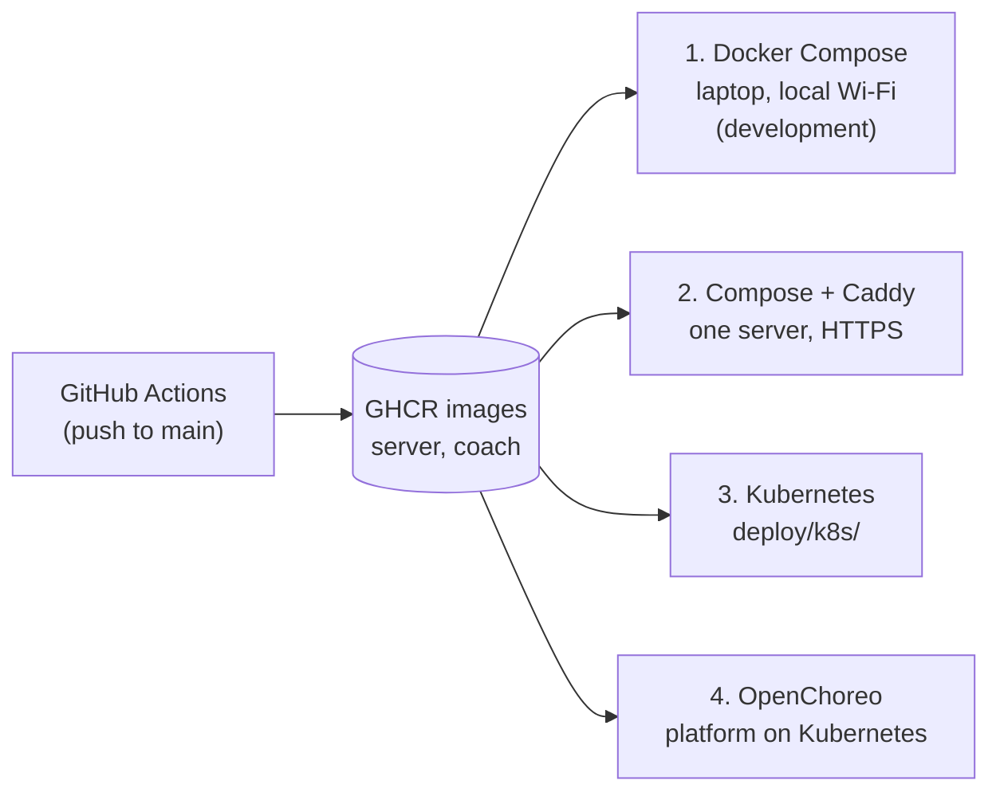
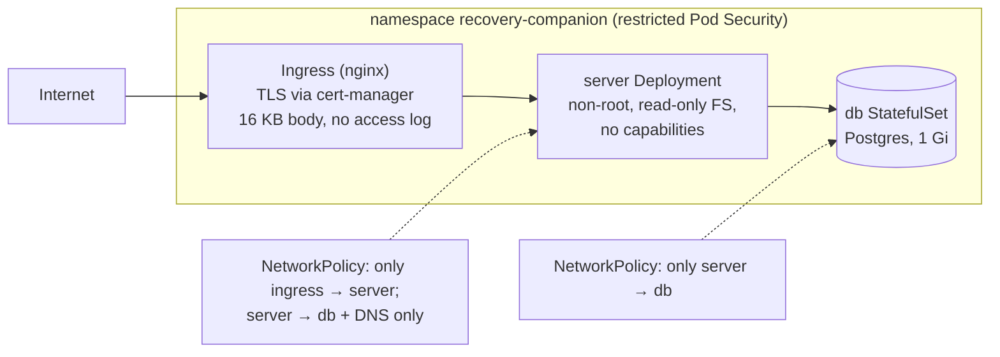

# Deployment guide

[Handbook home](README.md) · Previous: [Testing and CI/CD](TESTING_AND_CI_CD.md) · Next: [Developer guide](DEVELOPER_GUIDE.md)

This page explains the deployment options and **why** each is set up the way it is.
The exact commands and full CI/CD reference are in [deploy.md](../deploy.md).

## What gets deployed

| Piece | Deploy it? | How |
|---|---|---|
| The app | Yes, to phones | EAS Build → APK ([below](#android-builds-with-eas)) |
| Support-circle API + Postgres | Only if you use the circle | Docker Compose, Compose + HTTPS, or Kubernetes |
| Coach | **No public hosting** | Stays on the laptop next to Ollama, bound to `127.0.0.1` |

## Option overview



| Option | Good for | HTTPS | Files |
|---|---|---|---|
| 1. Docker Compose | Development and demos | No (plain http on the local Wi-Fi) | `docker-compose.yml` |
| 2. Compose + Caddy | A single small server | Yes, Let's Encrypt | `deploy/docker-compose.tls.yml`, `deploy/Caddyfile` |
| 3. Kubernetes | A cluster | Yes, ingress-nginx + cert-manager | `deploy/k8s/*.yaml` |
| 4. OpenChoreo | A platform team using OpenChoreo | Yes, platform gateway | Mapping and sketch in [deploy.md](../deploy.md#4-openchoreo) |

## 1. Docker Compose (default)

`make up` starts three containers:

| Service | Image | Port | Notes |
|---|---|---|---|
| `db` | `postgres:17-alpine` | inside Docker only | Volume `db-data` |
| `server` | built from `server/Dockerfile` | `8000` | Runs migrations, then the API, with no access log |
| `coach` | built from `coach/Dockerfile` (repo root context) | `127.0.0.1:8001` | Reaches Ollama on the host by default |
| `ollama` | `ollama/ollama` | — | Only with `--profile ollama` |

Phones on the same Wi-Fi reach the API at `http://<laptop-ip>:8000`. This is
**unencrypted**, so it is for development only.

## HTTPS with Docker Compose

```bash
API_DOMAIN=api.example.org \
  docker compose -f docker-compose.yml -f deploy/docker-compose.tls.yml up -d
```

What the override does, and why:

| Setting | Why |
|---|---|
| Adds a **Caddy** proxy on ports 80/443 that gets and renews a certificate by itself | Phones need `https://` for non-development builds |
| Removes the API's `8000` port | Only the proxy can reach the API |
| Caps request bodies at 16 KB | The API only takes tiny JSON bodies |
| Discards Caddy's logs; no access log | Logs could contain client addresses and paths |
| Fixed proxy address `172.30.0.10` and `SERVER_TRUSTED_PROXIES` set to it | The API trusts `X-Forwarded-For` only from Caddy, so per-address rate limits see each real client and cannot be spoofed |

Choose a **neutral domain name** (not "recovery" or "rehab"): public certificates are
listed in Certificate Transparency logs, which anyone can search.

## 3. Kubernetes

`deploy/k8s/` holds plain manifests, applied with Kustomize (`kubectl apply -k deploy/k8s`).



| File | Purpose |
|---|---|
| `namespace.yaml` | Namespace with the restricted Pod Security Standard |
| `secret.example.yaml` | Shape of the database secret. **Example only**: create the real one with `kubectl create secret` |
| `postgres.yaml` | Demo Postgres. Use a managed database for anything real |
| `server.yaml` | API Deployment and Service, `/health` probes, `SERVER_TRUSTED_PROXIES` for the pod network |
| `ingress.yaml` | HTTPS ingress; replace `api.example.org` |
| `networkpolicy.yaml` | Ingress and egress rules |

Important notes:

- Keep **one replica**: the API runs migrations at start-up.
- Pin the image **by digest** for real deployments.
- Set `SERVER_TRUSTED_PROXIES` to your cluster's pod network.
- Allow egress to `exp.host:443` only if you turn push on.

## 4. OpenChoreo

OpenChoreo is an open-source developer platform on Kubernetes. The API maps to an
OpenChoreo **Project** (`recovery-companion`) with a **Service component** running the
GHCR image, a REST endpoint on port 8000, and an external managed Postgres.

**Status: Planned.** The mapping and a YAML sketch are in
[deploy.md](../deploy.md#4-openchoreo), but no OpenChoreo deployment has been run in this
project. Check the field names against the OpenChoreo version you use.

## Android builds with EAS

| Profile (`app/eas.json`) | Used for | How |
|---|---|---|
| `development` | Your own phone, with live reload | `make build-android` (laptop) |
| `preview` | An installable APK to share for testing | GitHub Actions → **App preview (EAS)**, or `npx eas-cli build --profile preview --platform android` |

- Set `EXPO_PUBLIC_CIRCLE_API_URL` (an `https://` address) as an EAS environment
  variable for `preview` builds. Leave the coach URL empty for shared builds.
- Before a first laptop build, check what EAS would upload (it must not contain `.env`);
  the command is in [deploy.md](../deploy.md#app-builds-eas).
- No signing keys or secrets are kept in the repository.

## Before going beyond a demo

- Use managed, encrypted Postgres with backups.
- Pin every image by digest.
- Set up FCM if push is wanted, and review [privacy.md](../privacy.md) third parties.
- Get clinical, legal and ethics review. The project is a demo today.

## Related pages

- [deploy.md](../deploy.md): full commands and CI/CD details
- [Testing and CI/CD](TESTING_AND_CI_CD.md): how images are built
- [Safety and privacy](SAFETY_AND_PRIVACY.md): what the deployment must protect
