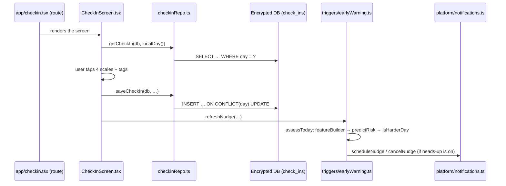

# Developer guide

[Handbook home](README.md) · Previous: [Deployment guide](DEPLOYMENT_GUIDE.md) · Next: [Project roadmap](PROJECT_ROADMAP.md)

How to find your way around the code, follow a feature from screen to storage, and
add to the project without breaking its safety and privacy rules.

## Repository map

```
app/                 Expo app (TypeScript)
  src/app/           Screens (Expo Router): one file per route, plus _layout.tsx
  src/features/      One folder per feature: screens, hooks, *Repo.ts (SQL)
  src/components/    Shared UI: ScreenLayout, HelpButton, ActionButton, SafeTextInput…
  src/storage/       Encrypted DB, migrations, settings, delete-all
  src/platform/      Phone/web adapters (*.ts and *.web.ts)
  src/ml/            On-device risk model, explanations, patterns, nudge timing
  src/safety/        Crisis detector
  src/net/           The only network code (circle and coach clients)
  src/i18n/locales/  en.json, si.json, ta.json
  src/theme/         Colours (light/dark), spacing
  src/dev/           Developer tools: demo data (development builds only)
  plugins/           Expo config plugin (disable Firebase auto-init)
server/              Support-circle API (FastAPI) + Alembic migrations
coach/               Coach service (FastAPI) + safety layer
ml/                  Synthetic data, training, evaluation, export
content/             Helplines, disclaimer, places, exercises, word lists
evals/               Coach safety cases + runner + report
tools/               Dependency allow-list, screenshot script
deploy/              Caddy HTTPS override, Kubernetes manifests
docs/                Design docs and this handbook
.github/workflows/   CI, images, EAS preview
.claude/             Claude Code hooks, reviewer agents, skills
```

## Where to start reading

1. `CLAUDE.md`: the rules every change must follow.
2. `app/src/app/_layout.tsx`: navigation, lock guard, session.
3. `app/src/features/session/boot.ts`: what happens at launch.
4. `app/src/app/index.tsx`: the home screen and links to every feature.
5. One feature end to end, e.g. the check-in (below).
6. `server/app/main.py` and `server/app/routes/`: the whole API is under 1,000 lines.
7. `coach/app/pipeline.py`: the coach in 30 lines.
8. `ml/train.py`: the model pipeline.

## Trace a feature: the daily check-in



The same shape repeats in every feature: **route → screen → repository → database**,
with logic in small, tested functions.

## Conventions

| Rule | Why | Enforced by |
|---|---|---|
| All user-facing text in `src/i18n/locales/*.json` | Three languages; reviewable wording | ESLint `i18next/no-literal-string`, `i18n.parity.test.ts` |
| Every screen inside `ScreenLayout` | Help button everywhere | `routes.test.tsx` |
| Text fields use `SafeTextInput` | No keyboard learning; crisis check | `textInputs.test.ts` |
| Network calls only in `src/net/` | Nothing leaves the phone by accident | `networkBoundary.test.ts` |
| SQL only in `*Repo.ts` and `storage/` | One place per table | Code review |
| Phone-only APIs behind `src/platform/` | Web demo keeps working | `webDemo.test.tsx` |
| Python: typed, `mypy --strict`, ruff | Fewer bugs | `make lint` |
| Tests first | Acceptance criteria become tests | Milestone process |
| No secrets in code | `.env` only | Review, `.gitignore` |

## Platform adapters

Metro (the app's bundler) picks `name.web.ts` in the browser and `name.ts` on the
phone. Examples:

| Adapter | Phone | Web demo |
|---|---|---|
| `storage/db.ts` / `db.web.ts` | SQLCipher file | In-memory sql.js, unencrypted |
| `platform/secureStore.ts` / `.web.ts` | Android Keystore | In-memory map |
| `platform/biometrics.ts` / `.web.ts` | Fingerprint/face | Not available |
| `platform/notifications.ts` / `.web.ts` | Real local notifications | A "Simulate notification" stand-in |
| `platform/isWebDemo.ts` / `.web.ts` | `false` | `true` (shows the banner) |

Real phone behaviour must not change when a web stand-in is added.

## Common tasks

### Adding a screen

1. Create the feature folder `app/src/features/<name>/` with the screen component.
2. Add a route file `app/src/app/<name>.tsx` that re-exports it.
3. Register it inside `Stack.Protected` in `app/src/app/_layout.tsx`.
4. Wrap it in `ScreenLayout`; put all text in the three locale files.
5. Run `routes.test.tsx` and `a11y.labels.test.tsx`, which render the routes and
   check the help button and accessibility labels. Add the route to their lists if needed.

### Adding a database table or column

1. Append a new SQL string to `MIGRATIONS` in `app/src/storage/migrations/index.ts`
   (never edit an old one).
2. Add a repository in the feature folder and tests.
3. If it holds personal data, add it to `deleteAll` coverage and to
   [privacy.md](../privacy.md#data-inventory).

### Adding a coping exercise

Add `content/exercises/<id>.json` (id, type, duration, steps with i18n keys and
optional animation), add it to `EXERCISES` in `features/sos/exercises.ts`, add text in
en/si/ta (si/ta marked for review), and run the tests. Claude Code users can run
`/add-coping-exercise`.

### Adding a coach safety case

Add a case to `evals/safety_cases.yaml` with `id`, `category`, `language`, `message`
and `must` / `must_not` behaviours, then run `make safety-eval`. Claude Code users can
run `/add-safety-test`.

### Adding an API endpoint

1. Add a route function in `server/app/routes/` with typed Pydantic models in
   `schemas.py` (requests extend `Strict`).
2. Use `CurrentAccount` and `require_role` for auth.
3. Write tests with the fixtures in `server/tests/conftest.py`.
4. If you add a column: update `models.py`, add an Alembic migration, update
   `test_schema_allowlist.py` and [privacy.md](../privacy.md).
5. Add the client call in `app/src/net/circleClient.ts`.

### Adding a dependency

Add it to the package file, then to `tools/dependency_allowlist.json` in the same
pull request. Analytics, ad and tracking SDKs are refused. See
[Testing and CI/CD](TESTING_AND_CI_CD.md#dependency-allow-list).

### Changing the risk model

Edit `ml/features.py` **and** `app/src/ml/featureBuilder.ts` together, run `make ml`
(which regenerates `model.json` and the parity fixtures), then `make test-app`. The
quality gate stops a worse model from shipping.

### Adding a test

| Part | Where | Run |
|---|---|---|
| App | `__tests__/` next to the code, `*.test.ts(x)` | `cd app && npx jest <name>` |
| Server | `server/tests/test_*.py` | `cd server && uv run pytest -q -k <name>` |
| Coach | `coach/tests/test_*.py` | `cd coach && uv run pytest -q` |
| ML | `ml/tests/test_*.py` | `cd ml && uv run pytest -q` |

## Files you must not edit casually

| File | Why |
|---|---|
| `content/helplines.json`, `content/disclaimer.md` | Human-verified safety content. A Claude Code hook blocks AI edits |
| `.env` files | Secrets; never committed |
| `package-lock.json`, `uv.lock` | Change them only through the package manager |
| Shipped migrations | Add new ones instead |

## Related pages

- [System architecture](SYSTEM_ARCHITECTURE.md): the big picture
- [Testing and CI/CD](TESTING_AND_CI_CD.md): what must pass
- [Glossary](GLOSSARY.md): unfamiliar terms
