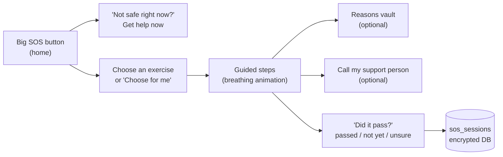
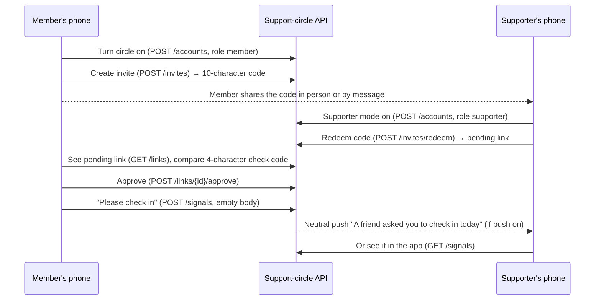

# Features

[Handbook home](README.md) · Previous: [Project overview](PROJECT_OVERVIEW.md) · Next: [System architecture](SYSTEM_ARCHITECTURE.md)

Each feature below lists its status, where its code lives and how it works.
Status labels are explained on the [handbook home](README.md#status-labels-used-in-this-handbook).
Screen routes live in `app/src/app/` (one file per screen, using Expo Router).
Feature logic lives in `app/src/features/<feature>/`.

## Summary

| Feature | Status | Screen(s) | Code |
|---|---|---|---|
| [Onboarding](#onboarding) | Implemented | `/onboarding` | `features/onboarding/` |
| [App lock and quick-hide](#app-lock-and-quick-hide) | Implemented | `/lock`, `/hidden` | `features/lock/`, `features/hide/` |
| [Help button and help screen](#help-button-and-help-screen) | Implemented | every screen, `/help` | `components/HelpButton.tsx`, `features/help/` |
| [Craving SOS](#craving-sos) | Implemented | `/sos` | `features/sos/` |
| [Reasons vault](#reasons-vault) | Implemented | `/vault` | `features/vault/` |
| [Daily check-in](#daily-check-in) | Implemented | `/checkin` | `features/checkin/` |
| [Trigger map and early warning](#trigger-map-and-early-warning) | Implemented | `/triggers`, `/coping-plan` | `features/triggers/`, `src/ml/` |
| [Support circle](#support-circle) | Implemented (push needs setup) | `/circle`, `/circle-invite`, `/supporter` | `features/circle/`, `server/` |
| [Shame-free slips](#shame-free-slips) | Implemented | `/slip` | `features/slip/` |
| [Progress](#progress) | Implemented | `/progress` | `features/progress/` |
| [Rebuild-your-life goals](#rebuild-your-life-goals) | Implemented | `/goals` | `features/goals/` |
| [Treatment and support finder](#treatment-and-support-finder) | Implemented | `/finder`, `/first-visit` | `features/finder/` |
| [AI coping coach](#ai-coping-coach) | Implemented (optional, laptop-hosted) | `/coach` | `features/coach/`, `coach/` |
| [Settings, about and delete-all](#settings-about-and-delete-all) | Implemented | `/settings`, `/about` | `app/settings.tsx`, `storage/deleteAll.ts` |
| [Languages and accessibility](#languages-and-accessibility) | Implemented (translations need review) | all | `src/i18n/`, `src/theme/` |
| [Web demo](#web-demo) | Implemented (development only) | all | `*.web.ts` files |

## Onboarding

**Status: Implemented.** Code: `app/src/features/onboarding/`.

Four steps (`steps.tsx`): choose a language → read and accept the disclaimer
(from `content/disclaimer.md`) → choose a nickname (optional, never a real name
needed) → set a PIN. Finishing sets `onboarded` in the encrypted settings table.

## App lock and quick-hide

**Status: Implemented.** Code: `app/src/features/lock/`, `app/src/features/hide/`.

- **PIN:** stored only as a salted PBKDF2 hash in the phone's secure store
  (`lock/pin.ts`). After 5 wrong tries there is a growing wait (30 s up to 15 min).
  After 15 failures in total, PIN entry stays off until biometric unlock or delete-all.
- **Biometric unlock** (fingerprint/face) is optional (`platform/biometrics.ts`).
- **Auto-lock:** the app locks when it comes back after a minute or more in the
  background (`lock/useAutoLock.ts`, `AUTO_LOCK_MS = 60_000`).
- **Quick-hide:** a "Hide" button on every screen, plus optional shake-to-hide on a
  phone (`hide/useShakeToHide.ts`), switches to a neutral "Notes" screen. It keeps
  the "Get help" button on purpose, because safety comes first.
- **Navigation guard:** `app/src/app/_layout.tsx` wraps every private screen in
  `Stack.Protected`, so nothing is reachable while locked or hidden.

## Help button and help screen

**Status: Implemented.** Code: `app/src/components/HelpButton.tsx`, `app/src/features/help/`.

- Every screen uses `ScreenLayout`, which always renders **Get help** (safety rule 2).
  `routes.test.tsx` renders every route and checks the button is shown.
- The help screen lists contacts from `content/helplines.json`, never from code
  (safety rule 3). Each shows its "last checked" date. Entries older than six
  months are marked as stale, and only a checked entry may appear as emergency
  services (`helplines.ts`, `isTrustedEmergency`).
- Calling uses a plain `tel:` link, opened only when the person taps.

## Craving SOS

**Status: Implemented.** Code: `app/src/features/sos/`, exercises in `content/exercises/`.

- Six exercises: slow breathing, box breathing, five senses, feet on the ground,
  urge surfing, change the scene (`content/exercises/*.json`; text is i18n keys).
- **"Choose for me"** picks the exercise that has helped most often. With no history,
  it picks one without breath-holding, because holding can feel worse when anxious
  (`stats.ts`, `pickExercise`).
- **Support person:** a name and number the user saves in the app. It never leaves
  the phone.
- The outcome is saved so the stats ("usually passes in about N minutes") and the
  trigger map can learn from it. Stats need at least 3 sessions (`MIN_FOR_TYPICAL`).

## Reasons vault

**Status: Implemented.** Code: `app/src/features/vault/`.

The person's own reasons for recovery, saved on a good day: text (up to 500
characters), photos (up to 1.5 MB) and voice notes (up to 60 s, 2 MB), at most 50
items (`vaultRepo.ts`). Media is stored as **BLOBs inside the encrypted database**,
never as loose files. The camera permission is not requested; photos come from the
gallery.

## Daily check-in

**Status: Implemented.** Code: `app/src/features/checkin/`, scale and tags in `content/checkin.json`.

- Four quick scales (0–4): mood, sleep, stress, cravings.
- Optional tags: alone, bored, tired, conflict, work stress, money worries, payday,
  celebration, pain, old routine, risky place.
- One check-in per local day (`check_ins.day` is unique). Saving again changes it.
- **Reminder** (optional): one daily local notification at a chosen time, with
  neutral text, because it may show on a locked or shared phone (`reminder.ts`).

## Trigger map and early warning

**Status: Implemented.** Code: `app/src/features/triggers/`, `app/src/ml/`.
More detail: [AI and ML](AI_AND_ML.md#the-risk-model).

Two separate things:

1. **Personal patterns** (`ml/patterns.ts`): simple comparisons of the person's own
   check-ins, with no model. Example: "In your check-ins, cravings were stronger on
   average on stressful days (2.0 vs 1.1)." Needs at least 14 check-ins.
2. **Early warning** (`triggers/earlyWarning.ts`): after today's check-in, the
   on-device risk model scores the day. On a "harder day" it shows a card with the
   main reasons ("poor sleep, high stress") and the person's own **coping plan**
   (`/coping-plan`: warning signs, what helps, who to contact).
3. **Heads-up notification** (optional, off by default): at most one a day, an hour
   before the person's usual hard time, never between 22:00 and 08:00, with neutral
   text: "Today might be a busy one. Your plan is there if you want it."
   (`ml/nudgeScheduler.ts`).

## Support circle

**Status: Implemented. Push notifications need FCM setup** (see below).
Code: `app/src/features/circle/`, `app/src/net/circleClient.ts`, `server/`.
More detail: [Backend guide](BACKEND_GUIDE.md), [API reference](API_REFERENCE.md).

The member invites up to 3 trusted people. With one tap (and a confirmation) the
member can send **"please check in on me"**. Nothing else is ever shared.

- **No names on the server.** The member gives each supporter a private label that
  stays on the phone (`circle_labels` table).
- **Check code:** both phones show the same 4 characters for a link
  (`checkCode` in `circleClient.ts`), so the member can tell the right person joined.
- **Limits:** 3 supporters, 3 signals a day, invite codes expire after 24 h.
- **Either side can leave at any time.** Delete-all also deletes the server account;
  when offline, the deletion is queued and retried at the next launch
  (`circle/credentials.ts`).
- **Push:** off by default (`SERVER_PUSH_ENABLED=false`) until Firebase Cloud
  Messaging is set up for the Expo project. Until then, supporters see requests when
  they open the app.

## Shame-free slips

**Status: Implemented.** Code: `app/src/features/slip/`.

- Care comes first: "if you or someone with you feels unwell or may have taken too
  much, get help now", with a button to the help screen.
- Then progress is shown as **kept**: "You have 45 strong days. They are still yours."
- Three optional, tap-only questions (where, feeling, what happened before). The
  answers are fixed option IDs, never free text (`questions.ts`), and feed the
  trigger map.
- It suggests reaching out: support person, help, circle, coping plan.
- A mistaken entry can be removed.

## Progress

**Status: Implemented.** Code: `app/src/features/progress/`, `features/slip/progress.ts`.

**Strong days** = finished days since the start without a slip. A slip removes
only its own day, so the number never goes back to zero (safety rule 5). A slip
logged today never lowers it, and the longest stretch never goes down. The screen
shows a ring filling towards the next milestone, a 4-week journey strip (slip days
are hollow neutral dots, never red) and stat tiles.

## Rebuild-your-life goals

**Status: Implemented.** Code: `app/src/features/goals/`.

Goals in five areas (sleep, health, work/study, family, money), up to 6 goals,
titles up to 80 characters. Each goal can get one "small win" a day, with milestone
celebrations. **Money towards your life** = daily amount (optional) × strong days
(`moneySaved.ts`), so it never resets either.

## Treatment and support finder

**Status: Implemented.** Code: `app/src/features/finder/`, data in `content/support_places.json`.

- Bundled with the app, so it works offline and makes no network request.
- Filters by type (treatment centre, counselling, support group) and area.
- Entries are validated (`places.ts`): broken or repeated entries are dropped, only
  `https` websites are allowed, and demo entries can never be dialled.
- **First-visit guide** (`/first-visit`): "what happens at your first visit", in
  three languages (`content/first_visit*.md`).

## AI coping coach

**Status: Implemented, optional, off by default.** It needs the coach service and
Ollama running on a laptop. Code: `app/src/features/coach/`, `coach/`.
More detail: [AI and ML](AI_AND_ML.md#the-ai-coping-coach).

A short chat that listens and suggests one coping skill at a time. It sits behind
four safety layers. A message with crisis words never leaves the phone. The chat is
kept only in the screen's memory and never saved.

## Settings, about and delete-all

**Status: Implemented.** Code: `app/src/app/settings.tsx`, `app/src/features/about/`,
`app/src/storage/deleteAll.ts`.

- Settings: language, biometric unlock, shake-to-hide, reminders, heads-up, circle,
  coach, and (in development builds only) **Developer tools → Load demo data**.
- About: the disclaimer, a 7-point privacy summary and the version.
- **Delete all my data:** removes the database key first (so any leftover file is
  unreadable), then the database, server accounts, secure-store entries, biometric
  token, scheduled notifications and temporary media. It is also reachable from the
  lock screen ("forgot PIN").

## Languages and accessibility

**Status: Implemented. Sinhala and Tamil text is marked `needs_review`** until a
native speaker checks it.

- All text lives in `app/src/i18n/locales/{en,si,ta}.json`. A lint rule forbids raw
  text in components, and `i18n.parity.test.ts` checks every key exists in all three.
- Every interactive element has an accessibility label and role, and tap targets are
  at least 48 dp (`a11y.labels.test.tsx`).
- Colour contrast is at least 4.5:1 in light and dark mode (`contrast.test.ts`).
- Text scales to 200%. At large sizes the header stacks and the SOS button widens.

## Web demo

**Status: Implemented, for development only.** Code: files ending in `.web.ts`.

The app runs in a browser (`make web`). Phone-only features use clearly labelled
stand-ins: an in-memory database that is gone on reload, no encryption, a PIN
instead of biometrics, and no shake. A yellow banner says "Web demo — not for real
data". See [Developer guide](DEVELOPER_GUIDE.md#platform-adapters).

## Related pages

- [System architecture](SYSTEM_ARCHITECTURE.md): how these features connect
- [Database guide](DATABASE_GUIDE.md): where each feature stores its data
- [Project roadmap](PROJECT_ROADMAP.md): features that are planned but not built
