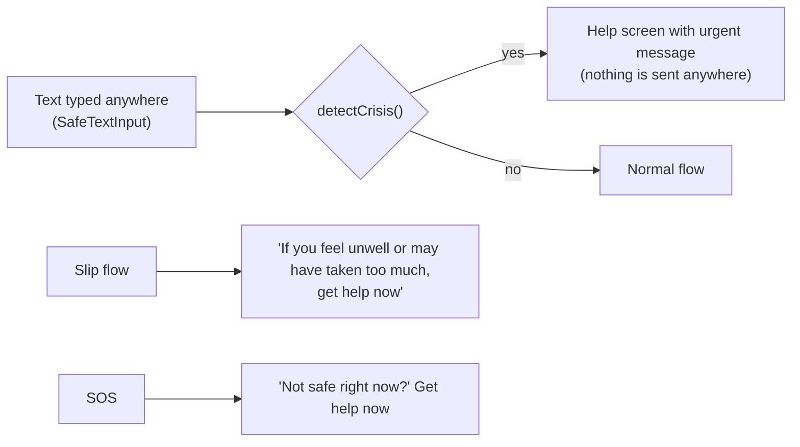

# Safety and privacy

[Handbook home](README.md) · Previous: [AI and ML](AI_AND_ML.md) · Next: [Setup and installation](SETUP_AND_INSTALLATION.md)

This page explains **how** the app protects people, and points to the code and tests
that enforce each protection. The complete threat model (adversaries, threats TH1–TH15
and mitigations) is in [privacy.md](../privacy.md#threat-model).

## Why it matters

People recovering from drug use can be harmed by a leak: stigma, family conflict, job
loss, legal risk. They may also be in danger during a crisis. So the app is designed
so that:

- **a leak has little to leak**: data stays on the phone, encrypted;
- **a mistake cannot hurt**: no medical advice, verified help contacts, crisis help first;
- **nobody is shamed**: progress survives a slip.

## Safety rules and how they are enforced

| # | Rule | How it is enforced | Test or check |
|---|---|---|---|
| 1 | No medical, dosing, drug-use, tapering or withdrawal advice | No such content in the app. The coach's topic guard refuses these questions; its output checker blocks doses, medicine names and withdrawal advice | Coach unit tests; safety eval (100% required on dosing and medical advice) |
| 2 | Help button on every screen | `ScreenLayout` always renders `HelpButton`; even the quick-hide screen keeps it | `routes.test.tsx` renders every route and checks the help button is shown |
| 3 | Helpline numbers only from `content/helplines.json` | `features/help/helplines.ts` loads and validates the file. The file is edited only by a person, after checking official sources, and carries a "last verified" date | A test bans phone-number patterns in `app/src`; an editor hook blocks AI tools from editing the file |
| 4 | Crisis words → help resources immediately | `safety/crisisDetector.ts` runs on text fields (en/si/ta, with spelling-trick handling) and opens help; the coach never receives such messages | Crisis tests on phone and service; shared `evals/fixtures/crisis_spelling.json` |
| 5 | No shame; a slip never resets progress | Strong days count finished days without a slip (`features/slip/progress.ts`) | `progress.test.ts`; `shameLanguage.test.ts` scans every string in all 3 languages using `content/shame_terms.json` |
| 6 | Synthetic or demo data only | `ml/generate.py`; demo rows marked `demo = 1`; the web demo banner | `model.json` records `trained_on: synthetic data` |

### Helpline numbers

The help screen shows each contact's **"last checked" date**. Entries older than six
months are marked as needing a re-check. Only a named, checked entry may appear as
the big red emergency button (`isTrustedEmergency`), because a wrong number must never
be the most prominent one. This handbook does not list the numbers: the content file
is the single source.

### Crisis handling

## Privacy controls

### 1. Data stays on the phone, encrypted

| Control | Where |
|---|---|
| SQLCipher database with a random 256-bit key | `app/src/storage/db.ts`, `key.ts` |
| Key, PIN hash and tokens in the Android Keystore | `expo-secure-store`, `storage/secureKeys.ts` |
| App refuses to start without SQLCipher (no silent plain storage) | `openDatabase` → `no_cipher` |
| Photos and voice notes inside the encrypted DB; temporary copies deleted and swept at every launch | `features/vault/`, `platform/mediaTemp.ts` |
| `secure_delete` overwrites deleted content | `storage/db.ts` |
| No cloud backup (`allowBackup=false`) | `app/app.json` |
| Only `src/net/` may use the network | Test enforced |

### 2. Consent before anything leaves the phone

Only **two** features send data, and both are **off by default**:

| Feature | Consent | What is sent |
|---|---|---|
| Support circle | Turning it on explains what the server sees. **Every** "please check in" shows a consent sheet with the exact text supporters will get (`features/circle/ConsentSheet.tsx`) | A random account ID, link IDs, a timestamp. Nothing else |
| AI coach | Opt-in screen (`features/coach/CoachOptIn.tsx`) explaining what is sent and that it is not a therapist | The message and up to 6 earlier turns, only if they contain no crisis words. Held in memory only |
| Supporter push | Turning on notifications in supporter mode | The supporter's Expo push token; pushes carry fixed neutral text |

### 3. The server knows almost nothing

- 5 tables of random IDs, hashes and timestamps ([Database guide](DATABASE_GUIDE.md#server-database-postgres)).
- Tokens and invite codes stored only as SHA-256 hashes.
- Requests with extra fields are refused; a signal must have an empty body.
- Account IDs are never returned to the other side of a link.
- No access log; database errors hide parameters.
- `test_schema_allowlist.py` fails if a column is added that is not on the allow-list.

### 4. Protection on a shared or lost phone

| Control | Where |
|---|---|
| PIN (4–6 digits, weak PINs refused), stored as a salted PBKDF2-SHA256 hash; lockouts after 5 wrong tries, PIN off after 15 | `features/lock/pin.ts` |
| Optional biometric unlock | `platform/biometrics.ts` |
| Auto-lock after 60 s in the background | `features/lock/useAutoLock.ts` |
| Quick-hide (button, optional shake) to a neutral "Notes" screen | `features/hide/` |
| No screenshots, screen recording or app-switcher preview (Android FLAG_SECURE) | `platform/secureScreen.ts` |
| Neutral installed name "Companion" | `app/app.json`, `appConfig.test.ts` |
| Neutral notification text; a test bans words like drug, craving, relapse, recovery; lock-screen visibility private | i18n `notifications` namespace |
| Keyboard learning off (no autocorrect, suggestions or autofill) | `components/SafeTextInput.tsx` |
| Delete all my data, also from the lock screen | `storage/deleteAll.ts` |

### 5. No tracking

No analytics, crash-reporting, advertising or AI-tracing SDKs. CI fails the build if
one appears anywhere in the dependency tree ([Testing and CI/CD](TESTING_AND_CI_CD.md#dependency-allow-list)).
Expo CLI telemetry is turned off in CI and the Makefile (`EXPO_NO_TELEMETRY=1`).

### 6. Secrets

- No secrets in code. Configuration comes from `.env` (never committed; `.gitignore`)
  and `.env.example` holds only placeholders.
- `.easignore` keeps `.env` and non-app folders out of EAS cloud builds.
- GitHub secrets (`EXPO_TOKEN`) are used only by the manual build workflow.

## Third parties

| Party | Gets | Mitigation |
|---|---|---|
| Expo push service + Firebase Cloud Messaging | Supporter push token, fixed neutral text | Push is off by default; Firebase auto-init and analytics are disabled (`app/plugins/withNoFirebaseAutoInit.js`) |
| EAS Build | Source code at build time | No secrets or user data in the source |
| GitHub | Source code, CI logs (synthetic data), images | No user data reaches CI |

## Honest limitations

- **Rooted or compromised phones** and OS malware are out of scope.
- **Someone forcing the person to unlock** cannot be fully prevented; quick-hide and
  delete-all help.
- **The SQLCipher test uses a test double.** On a real build, check once by hand that
  `recovery.db` does not start with `SQLite format 3` ([privacy.md](../privacy.md#out-of-scope-documented-limitations)).
- **Rule-based crisis and topic checks can miss new phrasing**; Sinhala and Tamil lists
  are drafts.
- **The link graph** between random IDs is visible to whoever runs the server.
- **No legal or regulatory review** has been done; the project is a demo.

## Related pages

- [privacy.md](../privacy.md): data inventory, threat model, list of privacy tests
- [AI and ML](AI_AND_ML.md): coach safety layers and evaluation
- [Deployment guide](DEPLOYMENT_GUIDE.md): HTTPS, logging and network rules on a server
