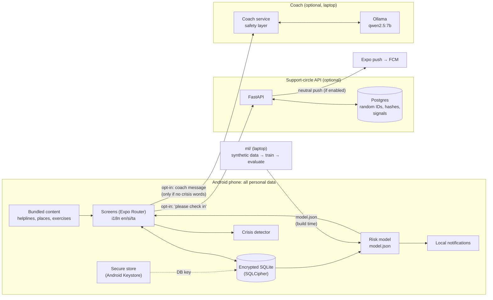
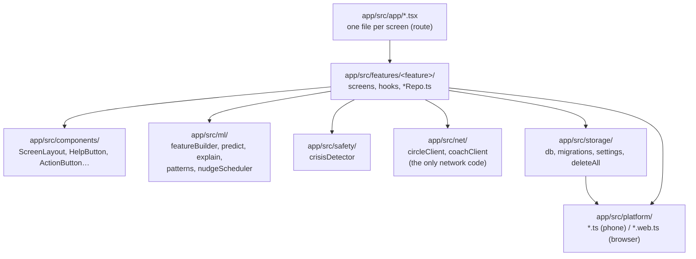
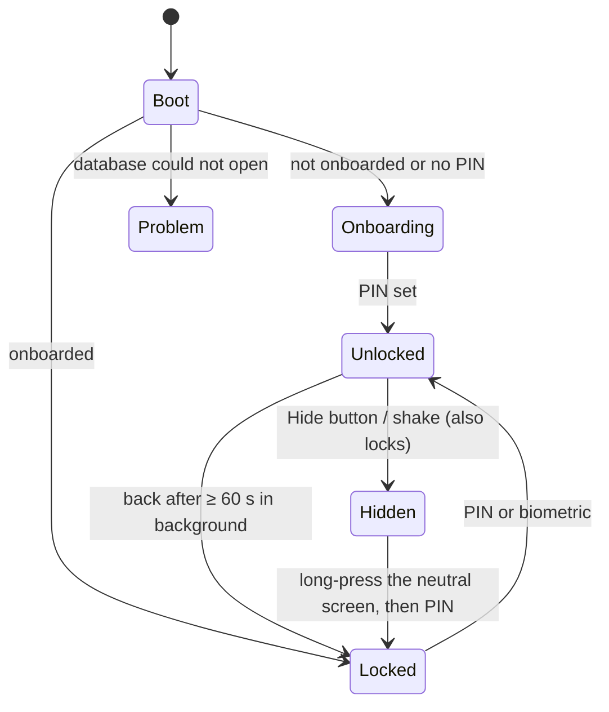
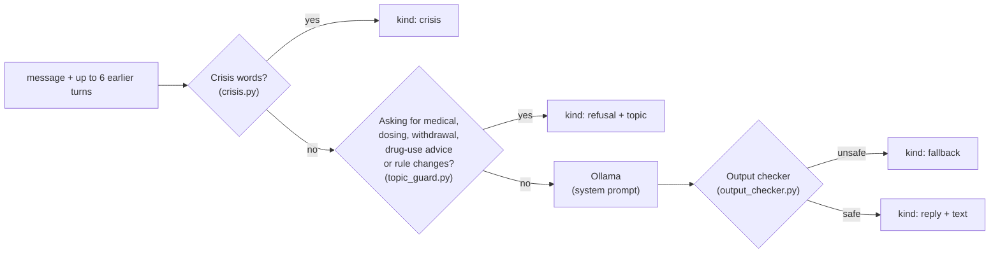
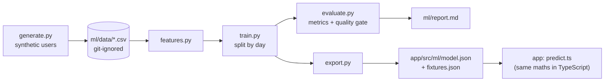

# System architecture

[Handbook home](README.md) · Previous: [Features](FEATURES.md) · Next: [Tech stack](TECH_STACK.md)

The main idea: **almost everything runs on the phone**. Two small services are
optional, and they see only what the person chooses to send. For the original
design decisions (D1–D13), see [architecture.md](../architecture.md).

## The big picture

## The five parts

| Part | Folder | Runs on | Job |
|---|---|---|---|
| **Mobile app** | `app/` | The phone (and a browser for development) | All features, all personal data |
| **Support-circle API** | `server/` | Laptop by default; a server or cluster if deployed | Relays "please check in" between random IDs |
| **Coach service** | `coach/` | The laptop, next to Ollama | Safety layer in front of a local language model |
| **ML pipeline** | `ml/` | The laptop and CI | Makes synthetic data, trains and checks the risk model, exports `model.json` |
| **Content** | `content/` | Bundled into the app (and two files into the coach image) | Help contacts, places, exercises, word lists, disclaimer |

## 1. The mobile app (frontend)

**Technology:** React Native + Expo (TypeScript), Expo Router. See [Tech stack](TECH_STACK.md).

### Layers inside the app

- **Routes** (`app/src/app/`) are thin: most re-export a screen from `features/`.
- **Repositories** (`*Repo.ts`, e.g. `checkinRepo.ts`) are the only code that runs SQL
  for a feature.
- **Only `src/net/` may use the network.** A test enforces this.
- **Platform adapters** (`src/platform/`) hide phone-only features. Metro picks
  `x.web.ts` in the browser and `x.ts` on the phone.

### Navigation and start-up

`app/src/app/_layout.tsx` wraps everything in `SessionProvider`. At launch
`features/session/boot.ts`:

1. clears any leftover temporary media,
2. retries queued support-circle account deletions (in the background),
3. gets or creates the 256-bit database key in the secure store,
4. opens the encrypted database and runs migrations,
5. loads settings and decides where to start: **onboarding** or **lock**.

Private screens sit inside `Stack.Protected` with `guard={unlocked}`, so they cannot
be reached while locked or hidden.

## 2. The support-circle API (backend)

**Technology:** Python 3.12, FastAPI, SQLAlchemy, Alembic, Postgres. Full detail in
[Backend guide](BACKEND_GUIDE.md) and [API reference](API_REFERENCE.md).

- 11 endpoints under 4 routers (`server/app/routes/`): accounts, invites, links, signals.
- Auth: a random bearer token per account. The server stores only its SHA-256 hash.
- 5 tables: `account`, `invite`, `link`, `signal`, `push_token`. No names, contacts,
  free text or health data. A test checks every column against an allow-list.
- An hourly background task deletes signals older than 7 days and expired invites.
- No access log (`uvicorn --no-access-log`).

## 3. The coach service (AI)

**Technology:** FastAPI + Ollama (local language model). Detail in [AI and ML](AI_AND_ML.md).

One endpoint, `POST /coach`. **Stateless:** no database, no files, and no message
text in any log. The pipeline (`coach/app/pipeline.py`):

The phone runs its own crisis check first, so crisis messages never reach the coach.

## 4. The ML pipeline

**Technology:** Python, scikit-learn, NumPy. Detail in [AI and ML](AI_AND_ML.md#the-risk-model).

The model is trained on a laptop (or in CI) and shipped **inside the app** as a small
JSON file. Scoring happens on the phone, so check-ins never leave it.

## 5. Data flow: what leaves the phone

| Data | Leaves the phone? | Where it goes |
|---|---|---|
| Check-ins, cravings, SOS sessions, slips, goals, vault, coping plan, nickname | **Never** | Encrypted DB only |
| Risk scores and patterns | **Never** | Computed on the phone |
| Support person's name and number | **Never** | Encrypted settings |
| Support-circle account | Only if the circle is turned on | A random ID and a token hash on the server |
| "Please check in" | Only when the member taps and confirms | A timestamp on the server, kept 7 days |
| Supporter push token | Only if a supporter turns on notifications | Server, then Expo and Firebase with fixed neutral text |
| Coach message | Only if the coach is turned on and the message has no crisis words | The coach service, in memory only |

Full inventory: [privacy.md](../privacy.md#data-inventory).

## Related pages

- [Tech stack](TECH_STACK.md): the tools behind each part
- [Developer guide](DEVELOPER_GUIDE.md): finding your way in the code
- [Deployment guide](DEPLOYMENT_GUIDE.md): how the services are run
