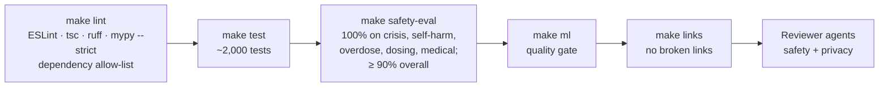
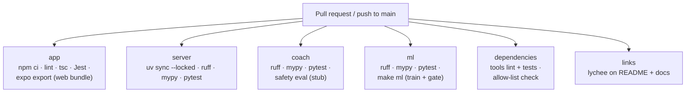

# Testing and CI/CD

[Handbook home](README.md) · Previous: [Setup and installation](SETUP_AND_INSTALLATION.md) · Next: [Deployment guide](DEPLOYMENT_GUIDE.md)

The project follows **tests first**: each milestone started by writing tests for its
acceptance criteria ([plan.md](../plan.md)). Safety and privacy rules are written as
tests too, so they cannot be broken by accident.

## Test suites at a glance

| Suite | Tool | Tests | Command | Location |
|---|---|---|---|---|
| App | Jest + React Native Testing Library | 1,629 | `make test-app` | `app/src/**/__tests__/` |
| Server | pytest | 71 | `make test-server` | `server/tests/` |
| Coach | pytest | 263 | `make test-coach` | `coach/tests/` |
| ML | pytest | 34 | `make test-ml` | `ml/tests/` |
| Tools | pytest | 50 | `make test-tools` | `tools/tests/` |
| Coach safety eval | `evals/run_eval.py` | 78 cases | `make safety-eval` | `evals/` |

Counts are from the M11 run; they grow as tests are added. `make test` runs all five
suites; `make lint` runs every linter and type checker plus the dependency allow-list.

## What the tests protect

### Safety and privacy tests (app)

| Test file | Protects |
|---|---|
| `routes.test.tsx` | Renders every route and checks the help button is shown (safety rule 2) |
| `crisisDetector.test.ts` | Crisis words in en/si/ta, with spelling tricks, open help |
| `shameLanguage.test.ts` | No shame words in any locale file |
| `noHardcodedNumbers.test.ts` | No phone numbers in code; helplines come only from content |
| `helplines.test.tsx`, `places.schema.test.ts`, `places.staleness.test.ts` | Content files are validated; stale entries flagged |
| `networkBoundary.test.ts` | Only `src/net/` may use the network; blocks tracking SDKs |
| `db.encryption.test.ts` | No key, a wrong key, or no SQLCipher → the database refuses to open |
| `deleteAll.test.ts` | Delete-all removes key, DB, server accounts, notifications, temp files |
| `notificationText.test.ts` | Notification text has no drug, craving, relapse or recovery words |
| `appConfig.test.ts` | Neutral installed name, blocked permissions |
| `pin.test.ts`, `autoLock.test.ts` | PIN hashing, lockouts, auto-lock |
| `textInputs.test.ts` | Every text field is a `SafeTextInput` |
| `progress.test.ts` | Slips never reset progress |
| `predict.parity.test.ts` | Phone and Python give the same risk scores |

### Quality tests (app)

| Test file | Protects |
|---|---|
| `a11y.labels.test.tsx` | Every interactive element on every screen has a label and role |
| `contrast.test.ts` | Colour contrast ≥ 4.5:1 in light and dark themes |
| `textScale.test.tsx` | Layout at large font sizes |
| `i18n.parity.test.ts` | Every key exists in en, si and ta, with the same placeholders |
| `offline.test.tsx` | Core features work with every network call failing |
| `webDemo.test.tsx` | The web demo banner and stand-ins |

### Backend, coach and ML tests

| Test file | Protects |
|---|---|
| `server/tests/test_schema_allowlist.py` | Only allowed columns exist, in models **and** the migration |
| `server/tests/test_invites.py`, `test_links.py`, `test_signals.py` | Business rules and rate limits |
| `server/tests/test_proxy_headers.py` | `X-Forwarded-For` trusted only from configured proxies |
| `server/tests/test_push.py` | Push text matches the app's reviewed i18n strings |
| `coach/tests/test_no_body_logging.py` | No message text in any log, on any path |
| `coach/tests/test_topic_guard.py`, `test_output_checker.py`, `test_crisis.py` | Each safety layer |
| `coach/tests/test_eval_cases.py` | The 78-case eval passes with the stub model; medical advice is a must-pass category |
| `ml/tests/test_generate.py` | Synthetic data is reproducible and contains the planted patterns |
| `ml/tests/test_train.py` | Split by day; logistic regression beats both baselines |
| `ml/tests/test_quality_gate.py` | The quality gate fails on worse or NaN metrics |
| `ml/tests/test_export.py` | `model.json` and the fixtures are correct |

## Quality gates

A change is "done" only when all of these pass ([CLAUDE.md](../../CLAUDE.md), definition of done):

### Dependency allow-list

`tools/check_dependencies.py` (run by `make deps-check` and `make lint`):

1. Every **direct** dependency in `app/package.json` and the four `pyproject.toml`
   files must be on `tools/dependency_allowlist.json`.
2. No analytics, advertising, crash-reporting or AI-tracing SDK may appear **anywhere
   in the lock files**, including transitive packages and npm aliases. Such names
   cannot be added to the allow-list either.
3. Every npm package must come from the npm registry (no `git:`, `file:`, URL or
   `npm:` alias specs).
4. A missing lock file is an error.

To add a dependency: install it, add its name to `dependency_allowlist.json` in the
same pull request, and run `make deps-check`.

## GitHub Actions

Three workflows in `.github/workflows/`. All actions are pinned to a full commit SHA,
checkout does not keep credentials, and jobs get read-only repository access.

### `ci.yml`: on every pull request and push to `main`

The safety eval report and the model report are added to each run's summary page;
`ml/report.md` and `model.json` are uploaded as an artifact.

### `server-image.yml`: images

| Trigger | Result |
|---|---|
| Pull request touching `server/`, `coach/` or the shared word lists | Builds both images (no push) |
| Push to `main` | Builds and pushes `ghcr.io/<owner>/recovery-companion-server` and `-coach`, tagged `sha-<short>` and `latest` |
| Tag `v*` (e.g. `v1.2.0`) | Also tagged with the version (`1.2.0`) |

Only this job has `packages: write`.

### `app-preview.yml`: Android APK (manual)

Actions → **App preview (EAS)** → Run workflow. It installs packages **before** the
Expo token is in the environment, pins the EAS CLI version, and queues a `preview`
build on EAS. It needs an `EXPO_TOKEN` repository secret.

## Release workflow

There is no automated app-store release. The current flow:

1. Work on a branch; open a pull request; CI must pass.
2. Merge to `main` → server and coach images are pushed to GHCR.
3. Optional: tag a version (`git tag v1.0.0 && git push --tags`) → version-tagged images.
4. Run **App preview (EAS)** for an installable APK.

Recommended: in GitHub Settings → Branches, require the `CI` checks before merging.

## Reviewer agents

For changes made with Claude Code, two read-only reviewer agents in `.claude/agents/`
are part of the definition of done: `safety-reviewer` (screens, text, notifications,
coach) and `privacy-reviewer` (storage, server, sync, auth, notifications). A third,
`test-writer`, writes and runs tests.

## Related pages

- [Deployment guide](DEPLOYMENT_GUIDE.md): where the images go
- [deploy.md](../deploy.md#cicd): CI/CD reference
- [Developer guide](DEVELOPER_GUIDE.md#adding-a-test): how to add tests
